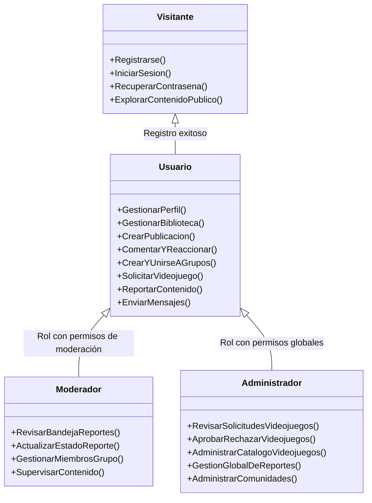

# Requisitos del sistema

## Identificación de los actores del sistema: visitante, usuario, moderador y administrador

### Introducción y modelo de actores

En el análisis de la plataforma **Let's Play**, los actores representan a los usuarios o entidades externas que interactúan directamente con los procesos, páginas web y formularios del sistema.

Para la arquitectura funcional del proyecto se identifican **cuatro actores humanos principales** con diferentes niveles de privilegios y responsabilidades, además del **Sistema** como actor de soporte automatizado:

---

### Descripción detallada de los actores

#### Visitante (Usuario no autenticado / Invitado)

* **Definición:**  
  Persona que accede a la aplicación web a través de un navegador pero que **no cuenta con una sesión activa** (no se ha autenticado o aún no posee una cuenta registrada).

* **Objetivo principal:**  
  Conocer la propuesta de la plataforma, consultar información de acceso público y crear una cuenta o ingresar con sus credenciales.

* **Capacidades y funcionalidades identificadas en el proyecto:**
  * Acceder a las pantallas públicas iniciales de la aplicación (`PLogin`, `PRegistro`, `PRecuperar`).
  * **Registrar una cuenta de usuario:** Capturar nombre de usuario (máximo 12 caracteres alfanuméricos), correo electrónico único, fecha de nacimiento, género y contraseña cifrada (**RF-01**, **RF-02**, **RF-03**, **RF-90**, **RF-91**, **RF-92**; **CU-01**; **FRegistro**).
  * **Iniciar sesión:** Proporcionar credenciales para obtener un identificador de sesión y acceder al feed y funcionalidades privadas (**RF-04**, **RF-05**; **CU-02**; **FLogin**).
  * **Recuperar contraseña:** Solicitar el restablecimiento de contraseña mediante correo electrónico registrado en caso de extravío (**RF-62**, **RF-63**; **CU-05**; **FRecuperar**).
  * *(Opcional según visualización pública):* Visualizar información pública básica si el sistema habilita una vista previa del catálogo o grupos públicos sin interactuar.

* **Restricciones del actor:**
  * **Acceso restringido (RF-07):** No puede interactuar con el feed, publicar contenido, comentar, reaccionar, unirse a grupos, enviar mensajes directos, solicitar videojuegos ni generar reportes. Debe autenticarse previamente.

---

#### Usuario (Usuario registrado / Jugador / Miembro de la comunidad)

* **Definición:**  
  Persona que cuenta con una cuenta activa y una sesión autenticada en el sistema. En los documentos del proyecto abarca los perfiles de *Jugador*, *Creador de contenido* o *Desarrollador* (que en esta fase comparten las mismas funciones base sin diferenciación de roles técnicos).

* **Objetivo principal:**  
  Participar activamente en la red social: compartir publicaciones, gestionar su biblioteca de juegos de interés, interactuar socialmente (comentarios, me gusta, mensajes), participar en comunidades públicas/privadas y sugerir nuevos videojuegos.

* **Capacidades y funcionalidades identificadas en el proyecto:**
  * **Gestión de cuenta y perfil:**
    * Consultar y modificar datos personales, descripción y fotografía de perfil (**RF-08**, **RF-10**, **RF-11**, **RF-12**; **CU-06**; **FPerfil**).
    * Consultar el perfil público de otros usuarios (**RF-09**).
    * Configurar su **biblioteca personal** asociando obligatoriamente entre **1 y 5 videojuegos aprobados** del catálogo oficial (**RF-88**, **RF-89**; **CU-06**).
    * Modificar su contraseña activa (**RF-61**; **CU-04**; **Formulario de cambio de contraseña**).
    * Eliminar su propia cuenta mediante confirmación explícita (**RF-60**, **RF-64**; **CU-07**).
    * Cerrar su sesión de forma segura (**RF-06**; **CU-03**).
  * **Feed y publicaciones:**
    * Visualizar el feed principal con publicaciones ordenadas de usuarios y grupos autorizados (**RF-20**, **RF-21**, **RF-22**; `PFeed`).
    * Crear publicaciones con texto y/o imágenes asociadas obligatoriamente a un videojuego registrado (**RF-13** a **RF-17**, **RF-86**; **CU-19**; **FPub**).
    * Visualizar publicaciones con autor, fecha y detalles (**RF-18**, **RF-19**).
    * Eliminar sus propias publicaciones con confirmación (**RF-65**).
  * **Interacciones sociales y mensajería:**
    * Reaccionar con "me gusta" y retirar su reacción en publicaciones (**RF-33**, **RF-34**, **RF-35**).
    * Agregar comentarios a publicaciones y ver el hilo de discusión (**RF-36**, **RF-37**, **RF-38**; **FComentario**).
    * Compartir publicaciones en la plataforma (**RF-39**, **RF-40**).
    * Enviar y recibir mensajes privados directos entre usuarios (**RF-76**, **RF-77**, **RF-78**; **FMensaje**).
  * **Comunidades y grupos:**
    * Consultar lista de grupos públicos disponibles (**RF-46**).
    * Unirse libremente a grupos públicos (**RF-47**; **CU-10**).
    * Enviar solicitud de ingreso a grupos privados (**RF-48**; **CU-11**; **FIngreso**).
    * Abandonar grupos a los que pertenezca (**RF-49**; **CU-13**).
    * Crear un grupo nuevo (público o privado) vinculando entre 1 y 5 videojuegos aprobados (**RF-41** a **RF-45**, **RF-84**; **CU-08**; **FGrupo**), asumiendo en dicho grupo el rol de **Administrador del Grupo**.
  * **Catálogo y solicitudes de videojuegos (Rol Jugador):**
    * Solicitar el registro de un nuevo videojuego proporcionando nombre, descripción, género, plataforma, imagen y detalles (**RF-23**, **RF-24**, **RF-25**; **CU-14**; **FSolicitudJuego**).
    * Recibir notificaciones del estado de su solicitud (aprobada/rechazada) (**RF-31**).
  * **Reportes:**
    * Reportar publicaciones, comentarios, perfiles o grupos que infrinjan normas, indicando motivo, descripción y evidencia opcional (**RF-93**, **RF-94**, **RF-95**; **CU-17**; **FReporte**).

* **Restricciones del actor:**
  * No puede eliminar ni editar publicaciones o comentarios ajenos (**RF-66**).
  * No puede acceder al contenido interno ni a publicaciones de grupos privados si no ha sido aceptado como miembro (**RF-55**, **RF-56**).
  * No puede editar directamente la base de datos oficial de videojuegos ni gestionar las páginas oficiales de los juegos (**RF-70**).

---

#### Moderador (Gestor de Contenido y Convivencia)

* **Definición:**  
  Usuario de confianza designado para salvaguardar la calidad del contenido y velar por la sana convivencia y el cumplimiento del reglamento comunitario dentro de la plataforma.  
  *Nota sobre el proyecto:* En los requisitos iniciales (**RF-96**, **RF-97**; **CU-18**), la atención de reportes se asignó temporalmente al administrador de la plataforma "sin aplicar sanciones", pero la especificación académica y de ingeniería de software distingue al **Moderador** como el actor encargado del filtro operativo de reportes y supervisión comunitaria, liberando al Administrador de las tareas cotidianas de soporte. Asimismo, se manifiesta a nivel de comunidades como **Moderador/Administrador del Grupo**.

* **Objetivo principal:**  
  Revisar, atender y clasificar los reportes emitidos por la comunidad sobre publicaciones, comentarios, perfiles y grupos inadecuados, además de gestionar la admisión y disciplina dentro de los grupos que modera.

* **Capacidades y funcionalidades identificadas en el proyecto:**
  * **Gestión y revisión de reportes comunitarios:**
    * Consultar la bandeja de reportes pendientes sobre publicaciones, comentarios, perfiles o grupos (**RF-96**; **CU-18**; `PReportes`).
    * Evaluar el contenido reportado y la evidencia adjunta (**CU-18**; **FRevReporte**).
    * Actualizar el ciclo de vida del reporte: *Pendiente*, *En revisión*, *Atendido* o *Cerrado* (**RF-97**; **CU-18**).
    * Agregar notas y comentarios de revisión para documentar las decisiones tomadas (**FRevisionReporte**).
  * **Moderación a nivel de grupo (Administrador/Moderador de Grupo):**
    * Evaluar y resolver solicitudes de admisión a grupos privados, aprobando o rechazando el ingreso de usuarios (**RF-48**, **RF-50**; **CU-12**; **FDecisionIngreso**).
    * Expulsar o dar de baja a integrantes del grupo que incumplan las normas comunitarias (**RF-51**; **CU-13**).
    * Modificar la configuración, reglas internas e información del grupo (**RF-57**; **CU-09**).
    * Gestionar los videojuegos vinculados al grupo, asegurando que se mantengan siempre entre 1 y 5 juegos autorizados (**RF-85**; **CU-09**).
  * Todas las funciones propias de un **Usuario** estándar.

* **Restricciones del actor:**
  * En el alcance de la primera versión, el sistema no aplica sanciones automatizadas severas (como borrado masivo de cuentas o bloqueos automáticos definitivos; estas quedan limitadas a revisión y seguimiento administrativo).
  * No tiene autorización para alterar el catálogo global de videojuegos ni la infraestructura técnica de la plataforma (**RF-70**).
  * En un grupo, no puede alterar la página oficial del videojuego relacionado (**RF-57**).

---

#### Administrador (Administrador de la Plataforma / Superadministrador)

* **Definición:**  
  Usuario con el máximo nivel de privilegios y facultades de gestión dentro de la plataforma web *Let's Play*. Posee control integral sobre el catálogo oficial, supervisión global de comunidades y resolución técnica y normativa de la aplicación.

* **Objetivo principal:**  
  Garantizar el correcto funcionamiento de la plataforma, mantener un catálogo oficial de videojuegos verificado y consistente, y contar con la última palabra en la moderación y gobernanza del sistema.

* **Capacidades y funcionalidades identificadas en el proyecto:**
  * **Gestión y aprobación del catálogo oficial de videojuegos:**
    * Consultar la bandeja de solicitudes de nuevos videojuegos enviadas por los jugadores (**RF-26**; **CU-15**; `PRevJuego`).
    * Aceptar solicitudes de registro de videojuegos, lo que dispara la creación o habilitación de la página oficial del videojuego en la plataforma (**RF-27**, **RF-32**; **CU-15**; **FRevJuego**, `SSolicitudJuego`).
    * Rechazar solicitudes no procedentes registrando el motivo de rechazo y la fecha de la decisión (**RF-28**, **RF-29**, **RF-30**; **CU-15**; **FRevJuego**).
    * Administrar de forma exclusiva la información publicada en las páginas de videojuegos: editar títulos, descripciones, portadas, plataformas o géneros (**RF-67**, **RF-68**; **CU-16**; `PAdminJuego`, `SAdminJuego`).
    * Deshabilitar o retirar páginas de videojuegos que ya no deban mostrarse (**RF-69**; **CU-16**).
  * **Gobernanza global de moderación y reportes:**
    * Supervisar la totalidad de reportes generados y las acciones tomadas por los moderadores (**RF-96**, **RF-97**; **CU-18**).
    * Atender controversias de contenido y emitir resoluciones definitivas sobre publicaciones, grupos o usuarios infractores.
  * **Supervisión de comunidades y cuentas:**
    * Supervisar grupos públicos y privados, pudiendo intervenir en caso de grupos con contenido ilícito o nombres inapropiados.
    * Todas las facultades de un **Usuario** y un **Moderador**.

* **Restricciones del actor:**
  * Sus operaciones deben preservar la integridad y consistencia de la base de datos (relaciones de usuarios, bibliotecas, publicaciones, comentarios y videojuegos) (**RF-81**, **RF-82**, **RF-83**).

---

### Matriz comparativa de permisos por actor

La siguiente matriz resume los permisos de acceso y operación identificados en el sistema:

| Módulo / Funcionalidad | Visitante | Usuario | Moderador | Administrador | Requisitos asociados |
|---|:---:|:---:|:---:|:---:|---|
| **Registro de cuenta nueva** | ✔ | — | — | — | RF-01, RF-02, RF-90 a 92 |
| **Inicio de sesión y recuperación** | ✔ | ✔ | ✔ | ✔ | RF-04, RF-05, RF-62, RF-63 |
| **Gestión de perfil y biblioteca (1 a 5 juegos)** | ✖ | ✔ | ✔ | ✔ | RF-08, RF-10, RF-88, RF-89 |
| **Visualizar Feed principal** | ✖ | ✔ | ✔ | ✔ | RF-20, RF-21, RF-22 |
| **Crear publicaciones (texto/imagen + juego)** | ✖ | ✔ | ✔ | ✔ | RF-13 a 17, RF-86 |
| **Eliminar publicaciones propias** | ✖ | ✔ | ✔ | ✔ | RF-65 |
| **Eliminar publicaciones ajenas / moderar** | ✖ | ✖ | ✔ *(en grupo)* | ✔ *(global)* | RF-51, RF-56, RF-66 |
| **Interacciones (Me gusta, comentar, compartir)**| ✖ | ✔ | ✔ | ✔ | RF-33 a 40 |
| **Mensajería privada** | ✖ | ✔ | ✔ | ✔ | RF-76, RF-77, RF-78 |
| **Crear grupos (públicos o privados)** | ✖ | ✔ | ✔ | ✔ | RF-41 a 45, RF-84 |
| **Unirse a grupos públicos** | ✖ | ✔ | ✔ | ✔ | RF-46, RF-47 |
| **Aprobar/rechazar solicitudes de ingreso a grupo** | ✖ | ✖ | ✔ *(Admin grupo)* | ✔ | RF-48, RF-50, CU-12 |
| **Solicitar nuevo videojuego para catálogo** | ✖ | ✔ | ✔ | ✔ | RF-23 a 25, CU-14 |
| **Aprobar/rechazar solicitudes de videojuegos** | ✖ | ✖ | ✖ | ✔ | RF-26 a 30, CU-15 |
| **Editar/deshabilitar páginas de videojuegos** | ✖ | ✖ | ✖ | ✔ | RF-67 a 70, CU-16 |
| **Enviar reportes de infracción** | ✖ | ✔ | ✔ | ✔ | RF-93 a 95, CU-17 |
| **Revisar y actualizar estado de reportes** | ✖ | ✖ | ✔ | ✔ | RF-96, RF-97, CU-18 |

*Convenciones:*  
* ✔ : Cuenta con permiso directo para ejecutar la acción.
* ✖ : Acción restringida o denegada por reglas de negocio.  
* — : No aplica (ej. un usuario ya autenticado no requiere registrarse nuevamente).

---

### Conclusiones y trazabilidad con la arquitectura

1. **Visitante:** Se limita a las páginas cliente de autenticación (`PRegistro`, `PLogin`, `PRecuperar`) enviando formularios a `SAuth`.
2. **Usuario:** Es el núcleo operativo de la red social; interactúa con `PFeed`, `PPerfil`, `PPub`, `PGrupo`, `PMensajes`, enviando datos a `SPerfil`, `SPub`, `SGrupo` y `SMensaje`.
3. **Moderador:** Añade una capa de supervisión interactuando con `PReportes` y formularios de decisión de ingreso/membresía a grupos privados (`FIngreso`, `SGrupo`, `SReporte`).
4. **Administrador:** Es el único actor con acceso a `PRevJuego`, `PAdminJuego` y al proceso `SAdminJuego`, garantizando que el catálogo de videojuegos mantenga información oficial fidedigna.

---

## 2. Requisitos Funcionales

### Actores

- **Usuario:** persona que utiliza o desea utilizar la plataforma.
- **Jugador:** usuario que puede solicitar el registro de un videojuego.
- **Administrador del grupo:** usuario que creó un grupo o que tenga permisos de administración dentro de él.
- **Administrador de la plataforma:** usuario responsable de revisar y resolver las solicitudes de registro de nuevos videojuegos.
- **Sistema:** aplicación web responsable de validar, procesar y almacenar la información.

#### Requisitos de autenticación y cuentas

| ID | Requisito | Prioridad |
|---|---|---|
| RF-01 | El sistema deberá permitir que una persona cree una cuenta de usuario. | Alta |
| RF-02 | El sistema deberá solicitar y validar los datos necesarios para registrar una cuenta. | Alta |
| RF-03 | El sistema deberá impedir el registro de una cuenta con datos obligatorios inválidos o ya utilizados, cuando corresponda. | Alta |
| RF-90 | El sistema deberá permitir registrar la fecha de nacimiento del usuario. | Alta |
| RF-91 | El sistema deberá permitir registrar el género del usuario mediante una opción definida por el proyecto. | Alta |
| RF-92 | El sistema deberá validar que el nombre de usuario tenga máximo 12 caracteres alfanuméricos. | Alta |
| RF-04 | El sistema deberá permitir que un usuario inicie sesión con sus credenciales. | Alta |
| RF-05 | El sistema deberá validar las credenciales antes de conceder acceso a las funciones privadas. | Alta |
| RF-06 | El sistema deberá permitir que un usuario cierre su sesión. | Media |
| RF-07 | El sistema deberá restringir las funciones que requieren autenticación a usuarios con una sesión válida. | Alta |
| RF-61 | El sistema deberá permitir que un usuario cambie su contraseña después de iniciar sesión. | Alta |
| RF-62 | El sistema deberá permitir que un usuario solicite la recuperación de su contraseña cuando no pueda acceder a su cuenta. | Alta |
| RF-63 | El sistema deberá validar la identidad del usuario antes de permitir el cambio o recuperación de la contraseña. | Alta |

#### Requisitos de perfil

| ID | Requisito | Prioridad |
|---|---|---|
| RF-08 | El sistema deberá permitir que un usuario consulte su perfil. | Alta |
| RF-09 | El sistema deberá permitir que un usuario consulte la información pública del perfil de otro usuario. | Media |
| RF-10 | El sistema deberá permitir que un usuario edite la información personal definida para su perfil. | Alta |
| RF-11 | El sistema deberá permitir que un usuario agregue, cambie o elimine su fotografía de perfil. | Media |
| RF-12 | El sistema deberá guardar los cambios realizados en el perfil y mostrarlos posteriormente. | Alta |
| RF-60 | El sistema deberá permitir que un usuario elimine su propia cuenta desde su perfil. | Alta |
| RF-64 | El sistema deberá solicitar confirmación antes de eliminar una cuenta de usuario. | Alta |
| RF-88 | El sistema deberá permitir que un usuario relacione entre 1 y 5 videojuegos aprobados con su perfil para conformar su biblioteca personal. | Alta |
| RF-89 | El sistema deberá permitir que un usuario agregue, elimine o cambie los videojuegos relacionados con su perfil, manteniendo entre 1 y 5 videojuegos asociados. | Alta |

#### Requisitos de publicaciones

| ID | Requisito | Prioridad |
|---|---|---|
| RF-13 | El sistema deberá permitir que un usuario cree una publicación relacionada con un videojuego. | Alta |
| RF-14 | El sistema deberá permitir que una publicación contenga texto. | Alta |
| RF-15 | El sistema deberá permitir que una publicación contenga una imagen. | Alta |
| RF-16 | El sistema deberá validar que la información obligatoria de una publicación esté completa antes de guardarla. | Alta |
| RF-17 | El sistema deberá asociar cada publicación con el usuario que la creó y registrar su fecha de creación. | Alta |
| RF-18 | El sistema deberá permitir visualizar el contenido de una publicación junto con su autor. | Alta |
| RF-19 | El sistema deberá conservar las publicaciones almacenadas para que sigan disponibles después de cerrar la sesión. | Alta |
| RF-65 | El sistema deberá permitir que un usuario elimine sus propias publicaciones. | Alta |
| RF-66 | El sistema deberá impedir que un usuario elimine publicaciones creadas por otro usuario. | Alta |

#### Feed principal y visualización de contenido

| ID | Requisito | Prioridad |
|---|---|---|
| RF-20 | El sistema deberá mostrar a los usuarios autenticados un feed principal con las publicaciones disponibles. | Alta |
| RF-21 | El sistema deberá mostrar en el feed la información básica de cada publicación, incluyendo autor, contenido, fecha e interacciones disponibles. | Alta |
| RF-22 | El sistema deberá permitir que el usuario consulte las publicaciones del feed de forma ordenada y legible. | Alta |

#### Registro y aprobación de videojuegos

| ID | Requisito | Prioridad |
|---|---|---|
| RF-23 | El sistema deberá permitir que un jugador registrado solicite el registro de un nuevo videojuego en la plataforma. | Alta |
| RF-24 | El sistema deberá solicitar y validar los datos obligatorios del videojuego antes de enviar la solicitud. | Alta |
| RF-25 | El sistema deberá registrar cada solicitud de videojuego con el jugador que la creó, su fecha de envío y el estado de la solicitud. | Alta |
| RF-26 | El sistema deberá permitir que el administrador de la plataforma consulte las solicitudes pendientes de registro de videojuegos. | Alta |
| RF-27 | El sistema deberá permitir que el administrador de la plataforma acepte una solicitud de registro de videojuego. | Alta |
| RF-28 | El sistema deberá permitir que el administrador de la plataforma rechace una solicitud de registro de videojuego. | Alta |
| RF-29 | El sistema deberá actualizar el estado de la solicitud según la decisión tomada por el administrador. | Alta |
| RF-30 | El sistema deberá registrar la decisión del administrador y la fecha en que fue tomada. | Media |
| RF-31 | El sistema deberá informar al jugador el resultado de su solicitud, cuando esta haya sido aceptada o rechazada. | Media |
| RF-32 | El sistema deberá crear o habilitar la página del videojuego en la plataforma únicamente cuando la solicitud haya sido aceptada. | Alta |
| RF-67 | El sistema deberá permitir que el administrador de la plataforma administre la información de las páginas de videojuegos aceptados. | Alta |
| RF-68 | El sistema deberá permitir que el administrador de la plataforma actualice la información publicada en una página de videojuego. | Alta |
| RF-69 | El sistema deberá permitir que el administrador de la plataforma deshabilite o retire una página de videojuego conforme a las reglas definidas por el proyecto. | Media |
| RF-70 | El sistema deberá impedir que los usuarios registrados administren directamente las páginas de videojuegos. | Alta |

#### Requisitos de interacción social

| ID | Requisito | Prioridad |
|---|---|---|
| RF-33 | El sistema deberá permitir que un usuario indique que le gusta una publicación. | Alta |
| RF-34 | El sistema deberá permitir que un usuario retire su reacción de me gusta de una publicación. | Media |
| RF-35 | El sistema deberá mostrar el estado y/o cantidad de reacciones de una publicación. | Media |
| RF-36 | El sistema deberá permitir que un usuario agregue un comentario a una publicación. | Alta |
| RF-37 | El sistema deberá mostrar los comentarios asociados a una publicación. | Alta |
| RF-38 | El sistema deberá asociar cada comentario con el usuario que lo realizó y registrar su fecha de creación. | Alta |
| RF-39 | El sistema deberá permitir compartir una publicación, si esta funcionalidad se mantiene en el alcance final. | Media |
| RF-40 | Si se implementa la opción de compartir, el sistema deberá registrar al usuario que realizó la acción y mostrar la publicación compartida según la regla definida por el equipo. | Media |

#### Requisitos de grupos y comunidades

| ID | Requisito | Prioridad |
|---|---|---|
| RF-41 | El sistema deberá permitir que un usuario cree un grupo relacionado con uno o varios videojuegos disponibles en la plataforma. | Alta |
| RF-42 | El sistema deberá permitir que el creador defina si el grupo será público o privado. | Alta |
| RF-43 | El sistema deberá solicitar y validar los datos obligatorios del grupo antes de crearlo. | Alta |
| RF-44 | El sistema deberá asociar cada grupo con el usuario que lo creó. | Alta |
| RF-45 | El sistema deberá mantener la relación entre cada grupo y uno o varios videojuegos. | Alta |
| RF-46 | El sistema deberá permitir que un usuario consulte los grupos públicos disponibles. | Media |
| RF-47 | El sistema deberá permitir que un usuario se una directamente a un grupo público. | Alta |
| RF-48 | El sistema deberá permitir que un usuario solicite unirse a un grupo privado y deberá requerir la aprobación del administrador del grupo para conceder el acceso. | Alta |
| RF-49 | El sistema deberá permitir que un usuario abandone un grupo al que pertenece. | Alta |
| RF-50 | El sistema deberá permitir que el administrador del grupo gestione las solicitudes de ingreso a un grupo privado. | Media |
| RF-51 | El sistema deberá permitir que el administrador del grupo elimine a un integrante. | Media |
| RF-52 | El sistema deberá permitir que el administrador del grupo elimine el grupo, de acuerdo con las reglas definidas por el proyecto. | Alta |
| RF-53 | El sistema deberá permitir la creación y visualización de publicaciones dentro de un grupo. | Alta |
| RF-54 | El sistema deberá mostrar las publicaciones de un grupo público a sus usuarios autorizados según las reglas del grupo. | Alta |
| RF-55 | El sistema deberá restringir las publicaciones de un grupo privado a sus integrantes autorizados. | Alta |
| RF-56 | El sistema deberá impedir que un usuario sin permisos administre un grupo o acceda al contenido privado de un grupo. | Alta |
| RF-57 | El sistema deberá permitir que el administrador del grupo actualice la información y configuración del grupo, sin administrar la página del videojuego relacionado. | Alta |
| RF-84 | El sistema deberá exigir que todo grupo se relacione inicialmente con un mínimo de 1 y un máximo de 5 videojuegos aprobados. | Alta |
| RF-85 | El sistema deberá permitir que el administrador de un grupo agregue, elimine o edite los videojuegos relacionados, manteniendo siempre entre 1 y 5 videojuegos asociados. | Alta |
| RF-86 | El sistema deberá exigir que toda publicación realizada dentro de un grupo seleccione un videojuego relacionado con ese grupo. | Alta |
| RF-87 | El sistema deberá impedir que una publicación dentro de un grupo seleccione un videojuego que no esté relacionado con ese grupo. | Alta |
| RF-93 | El sistema deberá permitir que un usuario registre un reporte sobre una publicación, comentario, perfil o grupo. | Media |
| RF-94 | El sistema deberá solicitar el motivo y una descripción del reporte. | Media |
| RF-95 | El sistema deberá registrar cada reporte con el usuario que lo creó, el contenido reportado, la fecha y el estado del reporte. | Alta |
| RF-96 | El sistema deberá permitir que el administrador de la plataforma consulte los reportes pendientes. | Media |
| RF-97 | El sistema deberá permitir que el administrador de la plataforma actualice el estado de un reporte sin aplicar sanciones. | Media |

#### Mensajería privada

| ID | Requisito | Prioridad |
|---|---|---|
| RF-76 | El sistema deberá permitir que un usuario envíe mensajes privados a otro usuario, si esta funcionalidad se mantiene en el alcance final. | Media |
| RF-77 | El sistema deberá permitir que los usuarios autorizados consulten sus conversaciones y mensajes privados. | Media |
| RF-78 | El sistema deberá asociar cada mensaje con su remitente, destinatario y fecha de envío. | Media |

#### Persistencia y consistencia de la información

| ID | Requisito | Prioridad |
|---|---|---|
| RF-79 | El sistema deberá almacenar de forma persistente las cuentas y datos de los usuarios. | Alta |
| RF-80 | El sistema deberá almacenar los perfiles, publicaciones, imágenes, grupos, comentarios, reacciones, solicitudes de videojuegos y páginas de videojuegos. | Alta |
| RF-81 | El sistema deberá mantener las relaciones entre usuarios, publicaciones, comentarios, reacciones, grupos, mensajes y videojuegos. | Alta |
| RF-82 | El sistema deberá reflejar en la aplicación los cambios confirmados en la base de datos. | Alta |
| RF-83 | El sistema deberá informar al usuario cuando una operación no pueda completarse y no deberá guardar información incompleta o inconsistente. | Alta |

#### Decisiones pendientes del alcance

Los siguientes puntos aparecen en los documentos, pero requieren confirmación antes de convertirlos en requisitos definitivos:

1. **Compartir publicaciones:** aparece en el alcance, pero no en las prioridades ni en todos los criterios de finalización.
2. **Mensajes privados:** aparece en los criterios de finalización, pero no en la lista principal de funcionalidades ni en los entregables.
3. **Grupos:** se definió que los grupos pueden tener visibilidad pública o privada y que el ingreso a un grupo privado requiere aprobación obligatoria.
4. **Edición y eliminación de publicaciones, comentarios o imágenes:** no están descritas explícitamente en el alcance actual.
5. **Verificación de correo:** no está descrita explícitamente y debe confirmarse antes de incluirla.
6. **Tipos de usuario:** jugadores, desarrolladores y creadores de contenido están identificados como usuarios objetivo, pero el alcance indica que no habrá funcionalidades diferenciadas; por ello, en este borrador se consideran usuarios dentro de la misma plataforma.

---

## 3. Requisitos no funcionales

Los requisitos no funcionales definen las condiciones que deberá cumplir el sistema, sin depender de las funciones. Su propósito es establecer criterios verificables para garantizar que la plataforma sea segura, eficiente, accesible y respetuosa con la privacidad de los *Usuarios*.

### Seguridad (RNF-SEG)

|ID|Requisito no funcional|Criterio de aceptación|
|---|---|---|
|RNF-SEG-001|El sistema deberá almacenar las contraseñas utilizando algoritmos de hash seguros, como Argon2id o bcrypt, con salt individual|Ninguna contraseña deberá almacenarse en texto plano en la base de datos|
|RNF-SEG-002|El sistema deberá verificar la autenticación y autorización del usuario en el servidor antes de permitir el acceso a funcionalidades privadas|Las solicitudes realizadas sin autenticación deberán ser rechazadas|
|RNF-SEG-003|El sistema deberá implementar un mecanismo de control de acceso basado en roles y permisos (RBAC)|Un usuario común no podrá ejecutar operaciones exclusivas de moderadores o administradores|
|RNF-SEG-004|El sistema deberá garantizar que únicamente los integrantes autorizados puedan consultar el contenido de grupos privados|Un usuario externo al grupo no podrá consultar sus publicaciones, mensajes ni información interna.|
|RNF-SEG-005|El sistema deberá validar y sanitizar los datos recibidos mediante formularios y solicitudes HTTP para prevenir ataques como XSS e inyección SQL|Las entradas maliciosas no deberán ejecutarse ni alterar las consultas de la base de datos.|
|RNF-SEG-006|El sistema deberá validar los archivos multimedia antes de almacenarlos, verificando su formato, tamaño y tipo de contenido|Los archivos que no cumplan las restricciones establecidas deberán ser rechazados|
|RNF-SEG-005|El sistema deberá implementar mecanismos de protección contra intentos automatizados de acceso no autorizado|Los intentos repetitivos de inicio de sesión deberán estar sujetos a límites de frecuencia y controles de seguridad|

**¿Por qué estos requisitos?**

Porque *Let's Play* permite que los usuarios publiquen contenido, compartan imágenes, intercambien mesnajes y participen en grupos privados.

### Rendimiento (RNF-REN)

| ID | Nombre | Descripción | Criterio de aceptación |
|---|---|---|---|
| NFR-REN-001 | Usuarios concurrentes | El sistema deberá soportar al menos 20 usuarios concurrentes realizando operaciones habituales dentro de la plataforma. | La aplicación deberá permitir la actividad simultánea de 20 usuarios sin presentar errores críticos que impidan utilizar sus funcionalidades principales. |
| NFR-REN-002 | Tiempo de respuesta | El sistema deberá proporcionar tiempos de respuesta adecuados durante la navegación y ejecución de operaciones principales. | Al menos el 95 % de las solicitudes principales deberán responder en un máximo de 3 segundos bajo las condiciones de carga establecidas. |
| NFR-REN-003 | Procesamiento de solicitudes | El sistema deberá ser capaz de procesar al menos 40 solicitudes HTTP en un periodo de 30 segundos bajo las condiciones de prueba establecidas. | Las solicitudes deberán procesarse sin pérdida de información ni errores críticos. |
| NFR-REN-004 | Optimización de recursos multimedia | El sistema deberá optimizar las imágenes y demás recursos multimedia para reducir los tiempos de carga y el consumo de ancho de banda. | Las imágenes deberán utilizar formatos y tamaños adecuados, evitando cargas innecesarias de archivos de gran tamaño. |
| NFR-REN-005 | Integridad en operaciones concurrentes | El sistema deberá mantener la consistencia de la información cuando varios usuarios realicen operaciones simultáneas sobre los datos almacenados. | Las operaciones concurrentes no deberán generar registros duplicados, inconsistencias ni pérdida de información. |

## Privacidad y protección de datos

| ID | Nombre | Descripción | Criterio de aceptación |
|---|---|---|---|
| NFR-PRI-001 | Minimización de datos personales | El sistema deberá recopilar únicamente los datos personales necesarios para proporcionar sus funcionalidades. | Cada dato solicitado deberá tener una finalidad definida y los campos opcionales deberán identificarse claramente. |
| NFR-PRI-002 | Transparencia en el tratamiento de datos | El sistema deberá informar a los usuarios sobre los datos personales recopilados, sus finalidades y las condiciones de utilización. | Deberá existir un aviso de privacidad accesible que describa claramente el tratamiento de los datos personales. |
| NFR-PRI-003 | Acceso restringido a información personal | El sistema deberá limitar el acceso a los datos personales de acuerdo con los permisos y responsabilidades de cada usuario. | Los usuarios únicamente podrán consultar información para la que tengan autorización, evitando la exposición de datos privados mediante solicitudes directas. |
| NFR-PRI-004 | Privacidad de mensajes privados | El sistema deberá garantizar que las conversaciones privadas únicamente sean accesibles para sus participantes autorizados. | Los usuarios ajenos a una conversación no podrán consultar sus mensajes ni acceder a su contenido mediante solicitudes al servidor. |
| NFR-PRI-005 | Eliminación de cuentas y datos personales | El sistema deberá contemplar mecanismos para solicitar la eliminación de cuentas y el tratamiento correspondiente de sus datos personales. | Los datos deberán eliminarse o anonimizarse cuando corresponda, considerando las obligaciones legales de conservación de información. |
| NFR-PRI-006 | Protección de información en registros | El sistema deberá evitar almacenar información personal o sensible innecesaria en los registros técnicos (logs). | Los registros no deberán contener contraseñas, tokens de autenticación ni contenido privado innecesario. |
| NFR-PRI-007 | Conservación de datos | El sistema deberá establecer periodos de conservación para los datos personales y demás información almacenada. | Los datos que hayan dejado de ser necesarios deberán eliminarse o anonimizarse cuando corresponda, respetando las obligaciones legales aplicables. |

## Accesibilidad

| ID | Nombre | Descripción | Criterio de aceptación |
|---|---|---|---|
| NFR-ACC-001 | Contraste de colores | La interfaz deberá utilizar combinaciones de colores que permitan distinguir correctamente el texto y los elementos visuales. | El texto normal deberá mantener una relación de contraste mínima de 4.5:1 y el texto grande de 3:1. |
| NFR-ACC-002 | Texto alternativo para imágenes | Las imágenes que transmitan información relevante deberán contar con descripciones textuales alternativas. | Las imágenes informativas deberán incluir descripciones accesibles y las imágenes decorativas deberán poder ignorarse mediante tecnologías de asistencia. |
| NFR-ACC-003 | Accesibilidad de formularios | Los formularios deberán contar con etiquetas descriptivas, indicaciones claras y mensajes de error comprensibles. | Los campos deberán estar correctamente identificados y los errores deberán indicar cómo corregir la información proporcionada. |
| NFR-ACC-004 | Estructura semántica | La interfaz deberá utilizar elementos HTML semánticos que faciliten la interpretación del contenido mediante tecnologías de asistencia. | Los encabezados, formularios, botones y secciones deberán contar con una estructura coherente y accesible. |
| NFR-ACC-005 | Redimensionamiento del contenido | La interfaz deberá permitir ampliar el contenido textual sin perder información ni funcionalidad. | El contenido deberá poder ampliarse hasta un 200 % sin provocar pérdida de información o funcionalidad. |

## Verificación y validación

Los requisitos no funcionales deberán verificarse mediante pruebas específicas que permitan comprobar el cumplimiento de los criterios de aceptación establecidos.

| Categoría | Método de verificación | Herramientas sugeridas |
|---|---|---|
| Seguridad | Pruebas de vulnerabilidades, autenticación y autorización. | OWASP ZAP, OWASP ASVS. |
| Rendimiento | Pruebas de carga, concurrencia y medición de tiempos de respuesta. | Apache JMeter, Lighthouse. |
| Privacidad | Revisión del tratamiento, almacenamiento y acceso a datos personales. | Revisión de código y base de datos. |
| Accesibilidad | Evaluaciones automáticas y pruebas manuales de navegación y contraste. | Lighthouse, axe DevTools y lectores de pantalla. |

## 6. Referencias

- OWASP Foundation. *Application Security Verification Standard (ASVS).* https://owasp.org/www-project-application-security-verification-standard/
- OWASP Foundation. *OWASP Top 10.* https://owasp.org/www-project-top-ten/
- World Wide Web Consortium (W3C). *Web Content Accessibility Guidelines (WCAG) 2.2.* https://www.w3.org/TR/WCAG22/
- International Organization for Standardization. *ISO/IEC 25010.* https://www.iso.org/standard/35733.html
- OWASP Foundation. *Password Storage Cheat Sheet.* https://cheatsheetseries.owasp.org/cheatsheets/Password_Storage_Cheat_Sheet.html

### Atributos de Calidad

#### 1. Rendimiento

**Escenario:**

|Parte|Valor|
|---|---|
|Fuente|20 **Usuarios**|
|Estimulo|Realizan 40 peticiones en 30 segundos|
|Ambiente|Ejecución web|
|Artefactos|Sistema|
|Respuesta|Procesa las peticiones|
|Medida de respuesta|Con una latencia promedio de 3 segundos|

#### 2. Seguridad

**Escenario:**

|Parte|Valor|
|---|---|
|Fuente|Adversario|
|Estimulo|Intento no autorizado de desplegar información|
|Ambiente|Ejecución web|
|Artefactos|Sistema|
|Respuesta|La información solicitada solo está disponible para usuarios autorizados y autenticados|
|Medida de respuesta|Cantidad de información puede estar comprometida|

#### 3. Usabilidad

**Escenario:**

|Parte|Valor|
|---|---|
|Fuente|*Pull Request merged*|
|Estimulo|Nueva funcionalidad se unió a la rama principal sin conflictos|
|Ambiente|Producción|
|Artefactos|Sistema|
|Respuesta|La nueva funcionalidad fue desplegada y probada con ningún error|
|Medida de respuesta|En menos de 12 horas y con un esfuerzo menor a 24 horas/persona|

#### 4. Desplegabilidad

**Escenario:**

|Parte|Valor|
|---|---|
|Fuente|*Usuario*|
|Estimulo|Quiere cambiar una vista|
|Ambiente|Fase de diseño|
|Artefactos|Vista de la página|
|Respuesta|Se realiza el cambio|
|Medida de respuesta|Tomó menos de 3 horas en realizar y probar el cambio sin ningún efecto secundario|

#### 5. Modificabilidad

**Escenario:**

|Parte|Valor|
|---|---|
|Fuente|*Desarrollador*|
|Estimulo|Quiere cambiar una vista|
|Ambiente|Fase de diseño|
|Artefactos|Vista de la página|
|Respuesta|Se realiza el cambio|
|Medida de respuesta|Tomó menos de 3 horas en realizar y probar el cambio sin ningún efecto secundario|
