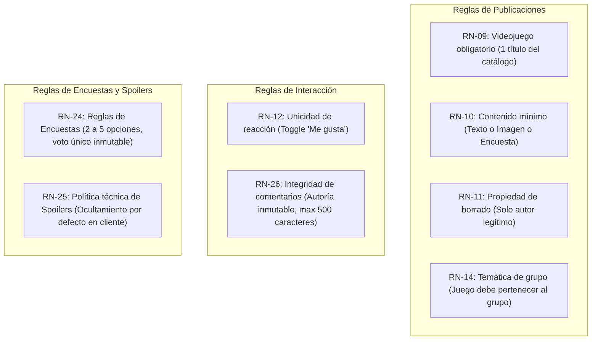
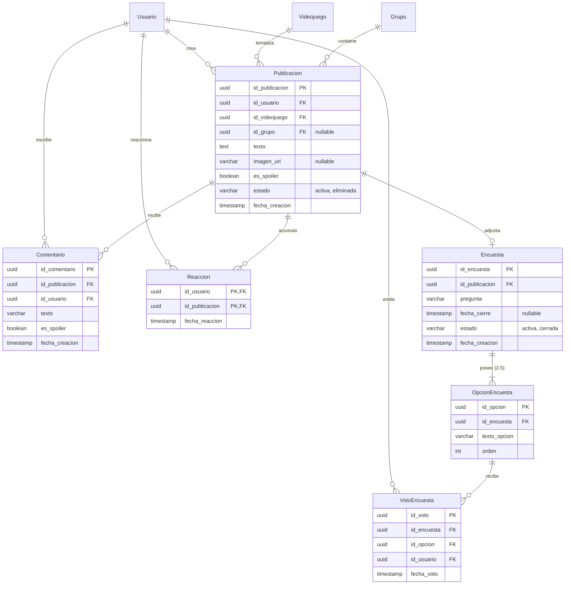

# 1.2.4 Documentación de Publicaciones, Comentarios, Reacciones, Encuestas y Spoilers — Let's Play

> **Proyecto:** Let's Play — Plataforma web para la comunidad de videojuegos  
> **Documento:** Especificación Funcional, Requisitos, Reglas de Negocio, Formularios y Casos de Uso del Módulo de Publicaciones e Interacciones  
> **Responsable:** Equipo de Desarrollo (Let's Play)  
> **Trazabilidad:** RF-13 a RF-19, RF-33 a RF-38, RF-65, RF-66, RF-86, RF-87, RF-117 a RF-126; CU-19, CU-39 a CU-45; RN-09 a RN-12, RN-14, RN-24 a RN-26.

---

## 1. Introducción y propósito del módulo

El presente documento formaliza de manera integral los cinco componentes centrales de interacción social y generación de contenido en la plataforma **Let's Play**:

1. **Publicaciones:** Creación, asociación temática a videojuegos obligatorios, visibilidad general o en grupos (públicos y privados), y eliminación de publicaciones con texto y contenido multimedia.
2. **Comentarios:** Hilos de discusión estructurados asociados a publicaciones activas, atribución al autor y ciclo de vida de los comentarios.
3. **Reacciones:** Mecanismo de interacción ligera basado en "Me gusta", con comportamiento de alternancia (*toggle* unívoco por usuario) y cómputo de métricas en tiempo real.
4. **Encuestas (Polls):** Creación de encuestas dinámicas adjuntas a publicaciones, con pregunta, opciones configurables (2 a 5 opciones), emisión de voto único por usuario, cálculo porcentual y fecha de expiración opcional.
5. **Control de Spoilers:** Mecanismo de advertencia y protección visual de la experiencia ajena contra revelaciones argumentales de videojuegos, permitiendo etiquetar publicaciones y comentarios como spoiler para difuminar/ocultar su contenido hasta que el usuario decida revelarlo.

Este módulo conforma el núcleo de la experiencia de usuario y comunidad en la aplicación web para escritorio.

```mermaid
flowchart TD
    U([Usuario Autenticado]) --> PFeed[Feed Principal / Página de Grupo]
    PFeed --> CrearPub[Crear Publicación\n(Texto, Imagen, Videojuego)]
    CrearPub --> OpcEncuesta{¿Incluye Encuesta?}
    OpcEncuesta -- Sí --> AdjuntarEncuesta[Definir Pregunta y 2-5 Opciones]
    OpcEncuesta -- No --> ChecarSpoiler
    AdjuntarEncuesta --> ChecarSpoiler{¿Contiene Spoiler?}
    ChecarSpoiler -- Sí --> MarcarSpoiler[Activar bandera es_spoiler]
    ChecarSpoiler -- No --> GuardarPub[Publicar en Servidor y BD]
    MarcarSpoiler --> GuardarPub
    
    GuardarPub --> VisualizarPub[Renderizado en Feed / Vista Detalle]
    VisualizarPub --> Interacciones[Interacciones de la Comunidad]
    
    Interacciones --> Reaccionar[Toggle 'Me gusta'\n(1 voto por usuario)]
    Interacciones --> Comentar[Comentar publicación\n(Texto + opción spoiler)]
    Interacciones --> VotarEncuesta[Votar en encuesta\n(Voto único no modificable)]
    Interacciones --> RevelarSpoiler[Hacer clic en 'Mostrar spoiler'\n(Desdifuminar contenido)]
```

---

## 2. Requisitos Funcionales del Módulo

### 2.1. Requisitos consolidados existentes (Publicaciones, Comentarios y Reacciones)

| ID | Requisito | Prioridad | Módulo |
|---|---|:---:|---|
| **RF-13** | El sistema deberá permitir que un usuario cree una publicación relacionada con un videojuego registrado. | Alta | Publicaciones |
| **RF-14** | El sistema deberá permitir que una publicación contenga texto descriptivo. | Alta | Publicaciones |
| **RF-15** | El sistema deberá permitir que una publicación contenga una imagen en formato compatible (.jpg, .png, .webp). | Alta | Publicaciones |
| **RF-16** | El sistema deberá validar que la información obligatoria de una publicación esté completa antes de guardarla. | Alta | Publicaciones |
| **RF-17** | El sistema deberá asociar cada publicación con el usuario que la creó y registrar su fecha de creación. | Alta | Publicaciones |
| **RF-18** | El sistema deberá permitir visualizar el contenido de una publicación junto con los datos públicos de su autor. | Alta | Publicaciones |
| **RF-19** | El sistema deberá conservar las publicaciones almacenadas para que permanezcan disponibles de manera persistente. | Alta | Publicaciones |
| **RF-33** | El sistema deberá permitir que un usuario indique que le gusta una publicación mediante una reacción. | Alta | Reacciones |
| **RF-34** | El sistema deberá permitir que un usuario retire su reacción de "me gusta" de una publicación previamente reaccionada. | Media | Reacciones |
| **RF-35** | El sistema deberá mostrar el estado activo de la reacción del usuario y el conteo total acumulado en cada publicación. | Media | Reacciones |
| **RF-36** | El sistema deberá permitir que un usuario agregue un comentario de texto a una publicación disponible. | Alta | Comentarios |
| **RF-37** | El sistema deberá mostrar los comentarios asociados a una publicación ordenados cronológicamente. | Alta | Comentarios |
| **RF-38** | El sistema deberá asociar cada comentario con el usuario autor y registrar su fecha y hora exacta de creación. | Alta | Comentarios |
| **RF-65** | El sistema deberá permitir que un usuario elimine sus propias publicaciones tras confirmación explícita. | Alta | Publicaciones |
| **RF-66** | El sistema deberá impedir que un usuario elimine publicaciones creadas por otros usuarios. | Alta | Publicaciones |
| **RF-86** | El sistema deberá exigir que toda publicación realizada dentro de un grupo seleccione forzosamente un videojuego relacionado con dicho grupo. | Alta | Publicaciones / Grupos |
| **RF-87** | El sistema deberá impedir que una publicación dentro de un grupo seleccione un videojuego no asociado a dicho grupo. | Alta | Publicaciones / Grupos |

### 2.2. Requisitos funcionales nuevos (Encuestas, Spoilers y Gestión de Comentarios)

| ID | Requisito | Prioridad | Módulo |
|---|---|:---:|---|
| **RF-117** | El sistema deberá permitir que un usuario adjunte una encuesta interactiva a una publicación, definiendo una pregunta y entre 2 y 5 opciones de respuesta. | Alta | Encuestas |
| **RF-118** | El sistema deberá permitir que un usuario autenticado emita un único voto por encuesta disponible. | Alta | Encuestas |
| **RF-119** | El sistema deberá calcular y mostrar el recuento numérico y porcentaje relativo de votos por cada opción de la encuesta en tiempo real tras la emisión del voto. | Media | Encuestas |
| **RF-120** | El sistema deberá impedir que un usuario vote más de una vez en la misma encuesta o modifique su voto una vez confirmado. | Alta | Encuestas |
| **RF-121** | El sistema deberá permitir que el creador de una encuesta configure opcionalmente una fecha y hora límite de expiración para la recepción de votos. | Media | Encuestas |
| **RF-122** | El sistema deberá deshabilitar la recepción de votos cuando una encuesta haya expirado o cuando el autor de la publicación decida cerrarla manualmente. | Media | Encuestas |
| **RF-123** | El sistema deberá permitir que un usuario marque explícitamente una publicación o un comentario como contenido con spoiler (`es_spoiler = true`). | Alta | Spoilers |
| **RF-124** | El sistema deberá enmascarar y difuminar automáticamente el texto e imágenes de publicaciones y comentarios marcados con spoiler tanto en el feed como en la vista de detalle. | Alta | Spoilers |
| **RF-125** | El sistema deberá proveer un control interactivo ("Mostrar spoiler" / "Ocultar spoiler") para que el lector decida voluntariamente revelar u ocultar el contenido protegido sin recargar la página. | Alta | Spoilers |
| **RF-126** | El sistema deberá permitir que un usuario elimine sus propios comentarios realizados en una publicación, actualizando el conteo total de comentarios. | Media | Comentarios |

---

## 3. Reglas de Negocio Específicas (RN)



| ID | Nombre de la regla | Descripción y validación formal | RF / CU Asociado |
|---|---|---|---|
| **RN-09** | **Vinculación obligatoria a un videojuego** | Toda publicación general debe estar asociada obligatoriamente a exactamente un videojuego aprobado del catálogo oficial. No se admiten publicaciones sin videojuego temático. | RF-13, RF-16<br>CU-19 |
| **RN-10** | **Contenido mínimo de una publicación** | Una publicación debe contener texto descriptivo (máximo 2000 caracteres), o una imagen adjunta válida, o una encuesta interactiva configurada. Al menos uno de estos tres elementos debe estar presente. | RF-14, RF-15, RF-117<br>CU-19, CU-42 |
| **RN-11** | **Propiedad y restricción de borrado** | Un usuario únicamente tiene permisos para eliminar publicaciones o comentarios de los cuales sea el autor original registrado. Los moderadores/administradores gestionan reportes según RN-23 sin borrado directo arbitrario. | RF-65, RF-66, RF-126<br>CU-40 |
| **RN-12** | **Unicidad de reacciones por usuario** | Un usuario puede tener como máximo una reacción ("Me gusta") por publicación. Si el usuario reacciona a una publicación donde ya reaccionó, la reacción previa se retira (acción de alternancia / *toggle*). | RF-33, RF-34, RF-35<br>CU-41 |
| **RN-14** | **Restricción temática de publicaciones en grupos** | Toda publicación realizada dentro de un grupo debe seleccionar forzosamente uno de los videojuegos vinculados a dicho grupo (1 a 5 títulos). El sistema rechazará publicaciones con títulos ajenos al grupo. | RF-86, RF-87<br>CU-19 |
| **RN-24** | **Reglas de estructura y votación en encuestas** | 1. La encuesta exige una pregunta de máximo 250 caracteres y entre **2 y 5 opciones** de respuesta (máximo 100 caracteres por opción).<br>2. Cada usuario autenticado puede emitir un único voto por encuesta; dicho voto es irreversible y no puede ser modificado ni eliminado.<br>3. Una vez que una encuesta recibe su primer voto, las opciones y la pregunta quedan bloqueadas y no pueden editarse.<br>4. Si la encuesta cuenta con fecha de expiración y esta se cumple, el sistema bloquea automáticamente la recepción de nuevos votos y exhibe los resultados finales definitivos. | RF-117, RF-118, RF-119, RF-120, RF-121, RF-122<br>CU-42, CU-43 |
| **RN-25** | **Política y renderizado de Spoilers** | 1. Cualquier publicación o comentario susceptible de revelar puntos clave de la trama o sorpresas argumentales debe marcarse mediante la opción de spoiler (`es_spoiler = true`) o el prefijo `[SPOILER]`.<br>2. La interfaz de usuario debe renderizar el contenido multimedia difuminado mediante filtros visuales (ej. blur CSS) y el texto cubierto por un bloque de enmascaramiento.<br>3. El contenido solo se revela cuando el usuario hace clic deliberadamente en el botón "Mostrar spoiler". La acción es local a la vista del cliente. | RF-123, RF-124, RF-125<br>CU-44, CU-45 |
| **RN-26** | **Integridad y límites de comentarios** | 1. El texto del comentario es obligatorio, con un mínimo de 1 carácter no vacío y un máximo de 500 caracteres.<br>2. Los comentarios quedan vinculados a una publicación activa; si la publicación padre es eliminada, sus comentarios asociados se eliminan en cascada lógica.<br>3. Los comentarios admiten marcación de spoiler independiente de la publicación padre. | RF-36, RF-37, RF-38, RF-123, RF-126<br>CU-39, CU-40 |

---

## 4. Formularios de Envío de Información

### 4.1. Formulario de Publicación (`FPub` enriquecido)

**Actor:** Usuario.  
**Objetivo:** Crear una publicación general o dentro de un grupo, con soporte multimedia, encuestas y advertencia de spoiler.

| Campo | Tipo de dato | Obligatorio | Validaciones y observaciones |
|---|---|:---:|---|
| Videojuego relacionado | `UUID` | Sí | Debe ser un juego aprobado. Si es en un grupo, debe ser uno de los juegos del grupo. |
| Texto de la publicación | `TEXT` | Condicional | Obligatorio si no hay imagen ni encuesta. Longitud: 1 a 2000 caracteres. |
| Imagen adjunta | `FILE / URL` | No | Formatos permitidos: `.jpg`, `.jpeg`, `.png`, `.webp`. Tamaño máx.: 5 MB. Almacenada en MongoDB/S3 con URL en PostgreSQL. |
| Grupo destino | `UUID` | No | Opcional. Si se omite, la publicación se emite en el feed general del usuario. |
| ¿Contiene spoiler? | `BOOLEAN` | Sí (Default: `false`) | Interruptor tipo *checkbox* o *toggle*. Si está activo, el post se clasifica con spoiler. |
| Adjuntar encuesta | `BOOLEAN` | No (Default: `false`) | Si se marca, despliega los campos del subformulario `FEncuesta`. |

**Acciones:** Publicar contenido, Cancelar.  
**Resultado esperado:** Se almacena la publicación asociada al usuario, fecha, videojuego, grupo (si aplica), estado de spoiler y su encuesta correspondiente si fue configurada.

---

### 4.2. Subformulario de Encuesta (`FEncuesta`)

**Actor:** Usuario creador de la publicación.  
**Objetivo:** Capturar los parámetros de una encuesta vinculada a la publicación.

| Campo | Tipo de dato | Obligatorio | Validaciones y observaciones |
|---|---|:---:|---|
| Pregunta de la encuesta | `VARCHAR(250)` | Sí | Longitud: 5 a 250 caracteres. No puede consistir solo de espacios en blanco. |
| Opción 1 | `VARCHAR(100)` | Sí | Primera opción de respuesta (1 a 100 caracteres). |
| Opción 2 | `VARCHAR(100)` | Sí | Segunda opción de respuesta (1 a 100 caracteres). |
| Opción 3 | `VARCHAR(100)` | No | Opción adicional opcional. |
| Opción 4 | `VARCHAR(100)` | No | Opción adicional opcional. |
| Opción 5 | `VARCHAR(100)` | No | Opción adicional opcional (máximo permitido: 5 opciones). |
| Duración / Fecha límite | `TIMESTAMP` | No | Opcional (1 día, 3 días, 7 días o fecha personalizada mayor a la actual). |

---

### 4.3. Formulario de Voto en Encuesta (`FVotoEncuesta`)

**Actor:** Usuario autenticado.  
**Objetivo:** Registrar la opción seleccionada por el usuario en una encuesta activa.

| Campo | Tipo de dato | Obligatorio | Validaciones y observaciones |
|---|---|:---:|---|
| ID de la encuesta | `UUID` | Sí | Debe corresponder a una encuesta activa no expirada. |
| ID de la opción seleccionada | `UUID` | Sí | Debe ser una de las opciones registradas para dicha encuesta. |

**Acciones:** Votar.  
**Resultado esperado:** El sistema valida que el usuario no haya votado previamente, registra el voto y devuelve los porcentajes actualizados.

---

### 4.4. Formulario de Comentario (`FComentario` enriquecido)

**Actor:** Usuario autenticado.  
**Objetivo:** Agregar una respuesta/comentario a una publicación.

| Campo | Tipo de dato | Obligatorio | Validaciones y observaciones |
|---|---|:---:|---|
| ID de la publicación | `UUID` | Sí | Publicación activa existente a comentar. |
| Texto del comentario | `VARCHAR(500)` | Sí | Longitud: 1 a 500 caracteres. Sanitización de etiquetas HTML/scripts. |
| ¿Contiene spoiler? | `BOOLEAN` | Sí (Default: `false`) | Indicador para advertir revelaciones de trama en el comentario. |

**Acciones:** Enviar comentario, Cancelar.  
**Resultado esperado:** Se crea el comentario asociado a la publicación, autor, fecha y bandera de spoiler.

---

## 5. Modelo de Datos y Persistencia Relacional (PostgreSQL)

El diseño relacional garantiza la integridad referencial, el aislamiento de votos únicos y el control estricto de las publicaciones:



### 5.1. Definición de Tablas Relacionales

#### Tabla: `Publicacion`
```sql
CREATE TABLE Publicacion (
    id_publicacion UUID PRIMARY KEY DEFAULT gen_random_uuid(),
    id_usuario UUID NOT NULL REFERENCES Usuario(id_usuario) ON DELETE CASCADE,
    id_videojuego UUID NOT NULL REFERENCES Videojuego(id_videojuego),
    id_grupo UUID NULL REFERENCES Grupo(id_grupo) ON DELETE SET NULL,
    texto TEXT NULL,
    imagen_url VARCHAR(500) NULL,
    es_spoiler BOOLEAN NOT NULL DEFAULT FALSE,
    estado VARCHAR(20) NOT NULL DEFAULT 'activa' CHECK (estado IN ('activa', 'eliminada')),
    fecha_creacion TIMESTAMP NOT NULL DEFAULT CURRENT_TIMESTAMP,
    fecha_actualizacion TIMESTAMP NULL
);
```

#### Tabla: `Comentario`
```sql
CREATE TABLE Comentario (
    id_comentario UUID PRIMARY KEY DEFAULT gen_random_uuid(),
    id_publicacion UUID NOT NULL REFERENCES Publicacion(id_publicacion) ON DELETE CASCADE,
    id_usuario UUID NOT NULL REFERENCES Usuario(id_usuario) ON DELETE CASCADE,
    texto VARCHAR(500) NOT NULL,
    es_spoiler BOOLEAN NOT NULL DEFAULT FALSE,
    fecha_creacion TIMESTAMP NOT NULL DEFAULT CURRENT_TIMESTAMP
);
```

#### Tabla: `Reaccion`
```sql
CREATE TABLE Reaccion (
    id_usuario UUID NOT NULL REFERENCES Usuario(id_usuario) ON DELETE CASCADE,
    id_publicacion UUID NOT NULL REFERENCES Publicacion(id_publicacion) ON DELETE CASCADE,
    fecha_reaccion TIMESTAMP NOT NULL DEFAULT CURRENT_TIMESTAMP,
    PRIMARY KEY (id_usuario, id_publicacion)
);
```

#### Tabla: `Encuesta`
```sql
CREATE TABLE Encuesta (
    id_encuesta UUID PRIMARY KEY DEFAULT gen_random_uuid(),
    id_publicacion UUID NOT NULL UNIQUE REFERENCES Publicacion(id_publicacion) ON DELETE CASCADE,
    pregunta VARCHAR(250) NOT NULL,
    fecha_cierre TIMESTAMP NULL,
    estado VARCHAR(20) NOT NULL DEFAULT 'activa' CHECK (estado IN ('activa', 'cerrada')),
    fecha_creacion TIMESTAMP NOT NULL DEFAULT CURRENT_TIMESTAMP
);
```

#### Tabla: `OpcionEncuesta`
```sql
CREATE TABLE OpcionEncuesta (
    id_opcion UUID PRIMARY KEY DEFAULT gen_random_uuid(),
    id_encuesta UUID NOT NULL REFERENCES Encuesta(id_encuesta) ON DELETE CASCADE,
    texto_opcion VARCHAR(100) NOT NULL,
    orden INT NOT NULL CHECK (orden BETWEEN 1 AND 5)
);
```

#### Tabla: `VotoEncuesta`
```sql
CREATE TABLE VotoEncuesta (
    id_voto UUID PRIMARY KEY DEFAULT gen_random_uuid(),
    id_encuesta UUID NOT NULL REFERENCES Encuesta(id_encuesta) ON DELETE CASCADE,
    id_opcion UUID NOT NULL REFERENCES OpcionEncuesta(id_opcion) ON DELETE CASCADE,
    id_usuario UUID NOT NULL REFERENCES Usuario(id_usuario) ON DELETE CASCADE,
    fecha_voto TIMESTAMP NOT NULL DEFAULT CURRENT_TIMESTAMP,
    CONSTRAINT uq_usuario_encuesta UNIQUE (id_encuesta, id_usuario)
);
```

---

## 6. Especificación Detallada de Casos de Uso

A continuación se presentan los casos de uso formales con la estructura canónica del proyecto:

---

### CU-19 — Crear publicación (Actualizado)

**RF asociados:** RF-13 a RF-19, RF-86, RF-87, RF-117, RF-123.  
**Actor principal:** *Usuario*.  
**Objetivo:** Compartir una publicación en el feed general o en un grupo, con soporte para texto, imagen, spoiler y encuesta interactiva.  
**Disparador:** El usuario presiona el botón "Crear publicación" en el feed o dentro de una comunidad.  
**Precondiciones:**
- El usuario debe tener una sesión activa y autenticada.
- Debe existir al menos un videojuego aprobado en el catálogo oficial.
- Si la publicación es en un grupo, el usuario debe ser miembro aceptado de dicho grupo.

**Flujo principal:**
1. El usuario abre el formulario de publicación (`FPub`).
2. El sistema muestra los campos de captura: selector de videojuego, área de texto, cargador de imagen opcional, selector de spoiler y opción para adjuntar encuesta.
3. Si la publicación es dentro de un grupo, el sistema filtra y exhibe únicamente los videojuegos (1 a 5) relacionados con ese grupo. Si es en el feed general, muestra los títulos del catálogo oficial.
4. El usuario selecciona el videojuego obligatorio.
5. El usuario ingresa texto y/o adjunta una imagen.
6. Si el usuario decide activar la advertencia de spoiler, marca la casilla correspondiente (`es_spoiler = true`).
7. Si el usuario decide adjuntar una encuesta, activa la opción y captura la pregunta y entre 2 y 5 opciones de respuesta.
8. El usuario presiona "Publicar".
9. El sistema valida que se cumpla RN-09, RN-10, RN-14 y RN-24.
10. El sistema almacena la publicación en la base de datos (junto con la encuesta si fue incluida).
11. El sistema muestra la nueva publicación en el feed correspondiente.
12. Termina el caso de uso.

**Flujos alternos:**
- **4.1. Videojuego no seleccionado:** El sistema deshabilita el botón de envío y solicita seleccionar un título válido.
- **5.1. Sin contenido mínimo:** Si el usuario no ingresó texto, imagen ni encuesta, el sistema muestra el error "La publicación debe incluir al menos texto, imagen o encuesta".
- **7.1. Encuesta con menos de 2 opciones:** El sistema alerta que se requieren al menos dos opciones para crear una encuesta.
- **7.2. Archivo multimedia inválido:** Si la imagen excede 5 MB o no cumple con el formato permitido, el sistema informa del error y solicita un archivo válido.

**Excepciones:**
- **EX01:** Error de comunicación con la base de datos o almacenamiento de imágenes: el sistema muestra mensaje de error sin guardar datos parciales (RN-04/RF-83).

---

### CU-39 — Agregar comentario a una publicación

**RF asociados:** RF-36, RF-37, RF-38, RF-123.  
**Actor principal:** *Usuario*.  
**Objetivo:** Participar en la discusión de una publicación activa mediante un comentario.  
**Disparador:** El usuario presiona "Comentar" en una publicación.  
**Precondiciones:**
- El usuario debe contar con una sesión activa.
- La publicación debe estar activa y accesible para el usuario (si es grupo privado, el usuario debe pertenecer al grupo).

**Flujo principal:**
1. El sistema muestra el área de comentarios y el formulario `FComentario` debajo de la publicación.
2. El usuario redacta su comentario (1 a 500 caracteres).
3. Si el comentario contiene revelaciones argumentales, el usuario marca la casilla "Contiene spoiler".
4. El usuario presiona "Enviar".
5. El sistema valida que el comentario no esté vacío y no exceda 500 caracteres.
6. El sistema guarda el comentario asociado al usuario, fecha y publicación.
7. El sistema renderiza el nuevo comentario al final del hilo de discusión.
8. Termina el caso de uso.

**Flujos alternos:**
- **5.1. Comentario vacío:** El sistema no procesa el envío.
- **5.2. Comentario con spoiler:** El sistema lo inserta con la máscara de spoiler activa.

---

### CU-40 — Eliminar publicación o comentario propio

**RF asociados:** RF-65, RF-66, RF-126.  
**Actor principal:** *Usuario*.  
**Objetivo:** Retirar una publicación o comentario creado previamente por el propio usuario.  
**Disparador:** El usuario hace clic en el icono de opciones y selecciona "Eliminar".  
**Precondiciones:**
- El usuario debe ser el autor legítimo del elemento.

**Flujo principal:**
1. El usuario selecciona "Eliminar" en su publicación o comentario.
2. El sistema solicita confirmación mediante un diálogo modal: "¿Estás seguro de eliminar este contenido? Esta acción no se puede deshacer".
3. El usuario confirma la eliminación.
4. El servidor verifica que el `id_usuario` autenticado coincida con el autor del registro.
5. El sistema elimina o desactiva el registro en la base de datos (con borrado en cascada para comentarios/votos asociados).
6. El sistema remueve visualmente el elemento de la interfaz e informa de la eliminación exitosa.
7. Termina el caso de uso.

**Flujos alternos:**
- **3.1. Cancelación:** El usuario cancela la confirmación; el sistema no altera el contenido.
- **4.1. Usuario no autorizado:** Si un usuario intenta eliminar contenido ajeno, el sistema rechaza la solicitud con error de autorización 403.

---

### CU-41 — Reaccionar a una publicación (Toggle "Me gusta")

**RF asociados:** RF-33, RF-34, RF-35.  
**Actor principal:** *Usuario*.  
**Objetivo:** Manifestar o retirar la reacción de aprobación ("Me gusta") sobre una publicación.  
**Disparador:** El usuario hace clic en el botón con icono de corazón / "Me gusta".  
**Precondiciones:**
- El usuario debe tener una sesión activa.

**Flujo principal:**
1. El usuario presiona el botón "Me gusta" de una publicación.
2. El sistema verifica si ya existe una reacción registrada del usuario sobre dicha publicación:
   - **Caso A (Sin reacción previa):** El sistema inserta el registro en `Reaccion`, activa el estado visual del botón (color distintivo) e incrementa el contador en +1.
   - **Caso B (Reacción existente):** El sistema elimina el registro en `Reaccion`, desactiva el estado visual del botón y decrementa el contador en -1.
3. El sistema actualiza el estado de la interfaz de inmediato.
4. Termina el caso de uso.

---

### CU-42 — Crear publicación con encuesta

**RF asociados:** RF-117, RF-121.  
**Actor principal:** *Usuario*.  
**Objetivo:** Crear una publicación temática que incluye una encuesta comunitaria.  
**Precondiciones:**
- El usuario está autenticado y en la pantalla de redacción de publicaciones.

**Flujo principal:**
1. El usuario selecciona la opción "Adjuntar encuesta" en el formulario de publicación.
2. El sistema despliega el subformulario `FEncuesta`.
3. El usuario escribe la pregunta (ej. "¿Cuál es tu juego del año?").
4. El usuario redacta al menos dos opciones obligatorias y opcionalmente añade hasta 3 opciones adicionales (total máx. 5).
5. El usuario define de manera opcional la duración de la votación (ej. 3 días).
6. El usuario selecciona el videojuego temático y presiona "Publicar".
7. El sistema valida las reglas de integridad de RN-24.
8. El sistema guarda la publicación y crea la entidad `Encuesta` con sus `OpcionEncuesta` relacionadas.
9. La publicación se muestra en el feed mostrando la encuesta interactiva con 0 votos.
10. Termina el caso de uso.

---

### CU-43 — Votar en una encuesta

**RF asociados:** RF-118, RF-119, RF-120, RF-122.  
**Actor principal:** *Usuario*.  
**Objetivo:** Participar en una encuesta activa eligiendo una de sus opciones.  
**Precondiciones:**
- El usuario debe estar autenticado.
- La encuesta debe estar en estado `activa` y dentro de su periodo de vigencia.
- El usuario no debe haber votado previamente en dicha encuesta.

**Flujo principal:**
1. El usuario visualiza la publicación con encuesta en el feed o vista de detalle.
2. Como el usuario aún no ha votado, el sistema muestra botones de opción interactivos para cada alternativa disponible.
3. El usuario selecciona una opción de respuesta.
4. El usuario presiona el botón "Votar".
5. El sistema envía la solicitud al servidor (`FVotoEncuesta`).
6. El servidor valida en una transacción:
   - Que la encuesta esté activa.
   - Que no exista un registro en `VotoEncuesta` con la misma tupla `(id_encuesta, id_usuario)`.
7. El servidor inserta el voto en `VotoEncuesta`.
8. El servidor calcula los totales y porcentajes actualizados para cada opción.
9. El sistema actualiza la vista de la encuesta en el cliente: reemplaza los botones de selección por barras de progreso con porcentaje, conteo de votos y una marca distintiva en la opción votada por el usuario.
10. Termina el caso de uso.

**Flujos alternos:**
- **6.1. Voto previo detectado:** El sistema rechaza la solicitud e informa: "Ya has emitido tu voto en esta encuesta".
- **6.2. Encuesta cerrada o expirada:** El sistema informa: "Esta encuesta ha concluido y no admite más votos", mostrando los resultados definitivos.

---

### CU-44 — Crear publicación o comentario con advertencia de spoiler

**RF asociados:** RF-123, RF-124.  
**Actor principal:** *Usuario*.  
**Objetivo:** Compartir información sobre la trama de un videojuego protegiendo a la comunidad contra spoilers accidentales.  
**Precondiciones:**
- El usuario está redactando una publicación o comentario.

**Flujo principal:**
1. El usuario introduce texto o imágenes que contienen información argumental sensible.
2. El usuario activa la casilla de verificación "Marcar como spoiler".
3. El sistema asigna el valor booleano `es_spoiler = true` en los datos del formulario.
4. El usuario envía la publicación o comentario.
5. El sistema almacena el registro conservando la bandera de spoiler.
6. El sistema presenta el contenido enmascarado/difuminado con la leyenda: *"Advertencia: Esta publicación contiene spoilers. Haz clic para ver el contenido"*.
7. Termina el caso de uso.

---

### CU-45 — Revelar u ocultar contenido con spoiler

**RF asociados:** RF-124, RF-125.  
**Actor principal:** *Usuario* (Lector).  
**Objetivo:** Visualizar voluntariamente el contenido oculto detrás de una advertencia de spoiler y volver a ocultarlo si se desea.  
**Precondiciones:**
- El usuario visualiza una publicación o comentario marcado con spoiler.

**Flujo principal:**
1. El lector observa una tarjeta de publicación o comentario con el contenido difuminado y una etiqueta central de advertencia: *"Contenido con spoiler"*.
2. El lector hace clic en el botón "Mostrar spoiler" o directamente sobre el área difuminada.
3. El sistema aplica la transición de interfaz retirando el filtro de desenfoque (`blur`) y mostrando el texto e imágenes nítidas.
4. El sistema cambia el botón a "Ocultar spoiler".
5. Si el usuario decide volver a ocultarlo, hace clic en "Ocultar spoiler", restituyendo el filtro protector.
6. Termina el caso de uso.

---

## 7. Lineamientos de Interfaz (UI/UX) y Soporte de Internacionalización (i18n)

En apego a las convenciones de `AGENTS.md`:

### 7.1. Diccionario de Textos de Interfaz (i18n)
Todos los textos del módulo deben contar con su clave respectiva en los diccionarios de idiomas (`es` y `en`):

| Clave i18n | Español (`es`) | Inglés (`en`) |
|---|---|---|
| `posts.createTitle` | Crear publicación | Create post |
| `posts.gameSelectPlaceholder` | Selecciona un videojuego... | Select a videogame... |
| `posts.contentPlaceholder` | ¿Qué estás jugando o pensando? | What are you playing or thinking? |
| `posts.spoilerCheck` | Contiene spoilers de la historia | Contains story spoilers |
| `posts.spoilerWarning` | Advertencia de Spoiler | Spoiler Warning |
| `posts.showSpoiler` | Mostrar spoiler | Reveal spoiler |
| `posts.hideSpoiler` | Ocultar spoiler | Hide spoiler |
| `posts.attachPoll` | Adjuntar encuesta | Attach poll |
| `poll.questionPlaceholder` | Pregunta de la encuesta... | Poll question... |
| `poll.optionPlaceholder` | Opción | Option |
| `poll.addOption` | Agregar opción (máx. 5) | Add option (max 5) |
| `poll.voteButton` | Votar | Vote |
| `poll.votesCount` | {count} votos | {count} votes |
| `poll.closedBadge` | Encuesta cerrada | Poll closed |
| `poll.alreadyVoted` | Ya has votado en esta encuesta | You have already voted in this poll |
| `comments.title` | Comentarios | Comments |
| `comments.writePlaceholder` | Escribe un comentario... | Write a comment... |
| `comments.spoiler` | Marcar comentario como spoiler | Mark comment as spoiler |
| `interactions.like` | Me gusta | Like |
| `interactions.deleteConfirm` | ¿Deseas eliminar este elemento? | Do you want to delete this item? |

---

## 8. Trazabilidad y Relaciones con Otros Módulos

* **Catálogo de Videojuegos:** Toda publicación se vincula obligatoriamente con la tabla `Videojuego`. Las encuestas permiten recopilar opiniones directamente sobre los títulos seleccionados.
* **Grupos y Comunidades:** En publicaciones dentro de grupos, el selector de videojuegos valida que el título pertenezca a la relación `ComunidadesVideojuegos` (1 a 5 títulos). Las publicaciones y encuestas en grupos privados mantienen el aislamiento restringido únicamente a los integrantes aceptados.
* **Sistema de Reportes (CU-17):** Cualquier usuario puede reportar una publicación o comentario que contenga spoilers no advertidos o encuestas que violen las reglas comunitarias, categorizándolo bajo la norma `RC-04 (Política de Spoilers)` o `RC-02 (Contenido Prohibido)`.
