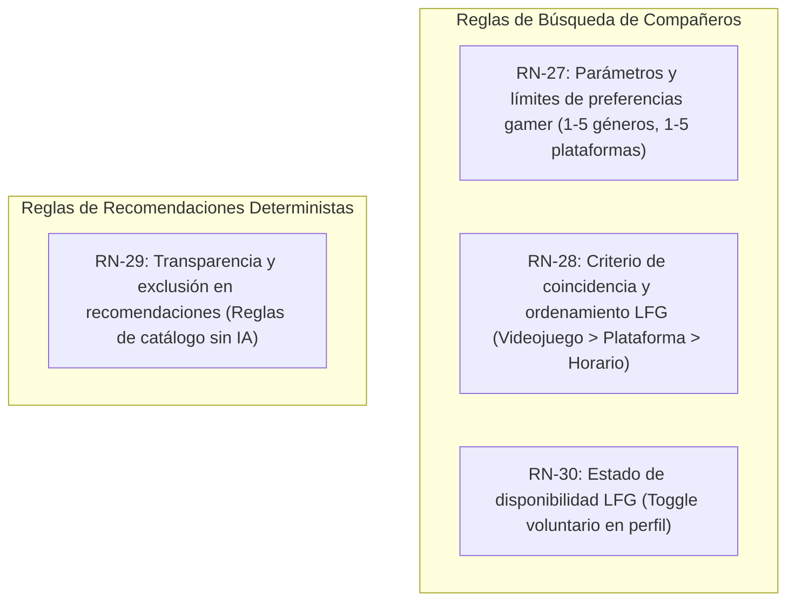

# 1.2.5 Documentación de Recomendaciones y Búsqueda de Compañeros de Juego — Let's Play

> **Proyecto:** Let's Play — Plataforma web para la comunidad de videojuegos  
> **Documento:** Especificación Funcional, Requisitos, Reglas de Negocio, Formularios y Casos de Uso del Módulo de Recomendaciones y Búsqueda de Compañeros (*Matchmaking / LFG*)  
> **Responsable:** Equipo de Desarrollo (Let's Play)  
> **Trazabilidad:** RF-08, RF-09, RF-88, RF-89, RF-114, RF-127 a RF-136; CU-20, CU-23, CU-36, CU-46 a CU-51; RN-06, RN-07, RN-27 a RN-30.

---

## 1. Introducción y propósito del módulo

Uno de los pilares esenciales de **Let's Play** como red social especializada es permitir a los jugadores **encontrar personas para jugar** y descubrir nuevo contenido de su interés dentro del ecosistema de videojuegos.

El presente documento especifica de manera formal dos subsistemas complementarios:

1. **Búsqueda de compañeros de juego (*LFG - Looking For Group / Matchmaking comunitario*):** Permite a los usuarios localizar otros jugadores con base en afinidades explícitas: videojuegos comunes en su biblioteca personal, plataformas compartidas (PC, consolas, móviles), disponibilidad horaria y modos de juego (casual, competitivo o cooperativo), además de permitir publicaciones de convocatoria de escuadrón.
2. **Recomendaciones:** Proporciona sugerencias transparentes y deterministas basadas en coincidencias directas de catálogo y preferencias del usuario (sin requerir algoritmos opacos de inteligencia artificial, respetando los límites de la primera versión):
   * *Videojuegos recomendados:* títulos populares del catálogo oficial y coincidencias por género y plataforma.
   * *Comunidades y grupos sugeridos:* grupos públicos vinculados a los títulos de la biblioteca del usuario.
   * *Jugadores sugeridos:* usuarios con alta coincidencia de videojuegos en su biblioteca y plataformas activas.

```mermaid
flowchart TD
    U([Usuario Autenticado]) --> PPref[Configurar Preferencias Gamer\n(Géneros, Plataformas, Horarios)]
    PPref --> GuardarPref[(Base de Datos: PreferenciaGamer)]
    
    U --> HubDescubrimiento[Página de Descubrimiento / Búsqueda]
    
    HubDescubrimiento --> ModuloLFG[Búsqueda de Compañeros\n(Filtros por Juego, Plataforma, Horario)]
    HubDescubrimiento --> ModuloRecom[Panel de Recomendaciones\n(Juegos, Grupos y Jugadores Afines)]
    
    ModuloLFG --> ListaJugadores[Resultados: Tarjetas de Jugadores Compatibles]
    ListaJugadores --> AccionConexion{Acción de Conexión}
    AccionConexion --> SeguirJugador[Seguir Usuario\n(CU-26)]
    AccionConexion --> MensajePrivado[Enviar Mensaje Directo\n(CU-35)]
    AccionConexion --> InvitarGrupo[Invitar a Grupo\n(CU-08 / CU-10)]
    
    ModuloRecom --> SugerenciasJuegos[Juegos del Catálogo por Género]
    ModuloRecom --> SugerenciasGrupos[Grupos Públicos de sus Juegos]
    ModuloRecom --> SugerenciasAmigos[Jugadores con Juegos en Común]
```

---

## 2. Requisitos Funcionales del Módulo

### 2.1. Requisitos base existentes vinculados

| ID | Requisito | Prioridad | Módulo |
|---|---|:---:|---|
| **RF-08** | El sistema deberá permitir que un usuario consulte la información de su propio perfil. | Alta | Perfil |
| **RF-09** | El sistema deberá permitir que un usuario consulte la información pública del perfil de otro usuario. | Media | Perfil |
| **RF-88** | El sistema deberá permitir que un usuario relacione entre 1 y 5 videojuegos aprobados con su perfil para conformar su biblioteca personal. | Alta | Biblioteca |
| **RF-89** | El sistema deberá permitir que un usuario agregue, elimine o cambie los videojuegos relacionados con su perfil, manteniendo siempre entre 1 y 5 títulos. | Alta | Biblioteca |
| **RF-114** | El sistema deberá permitir que un usuario busque contenido disponible en la plataforma mediante palabras o términos de búsqueda (usuarios, videojuegos, grupos y publicaciones). | Media | Búsqueda |

### 2.2. Requisitos funcionales nuevos (Búsqueda de Compañeros y Recomendaciones)

| ID | Requisito | Prioridad | Módulo |
|---|---|:---:|---|
| **RF-127** | El sistema deberá permitir que el usuario capture y actualice sus preferencias de juego: géneros predilectos (1 a 5), plataformas en las que juega (1 a 5) y franjas de disponibilidad horaria. | Alta | Preferencias / Perfil |
| **RF-128** | El sistema deberá proveer un motor de búsqueda de compañeros de juego (*LFG*) que permita filtrar usuarios por: videojuego específico, plataforma, disponibilidad horaria y estilo de juego. | Alta | Búsqueda de Compañeros |
| **RF-129** | El sistema deberá calcular y mostrar un indicador visual de coincidencia o afinidad porcentual entre el usuario autenticado y los jugadores resultantes de la búsqueda. | Media | Búsqueda de Compañeros |
| **RF-130** | El sistema deberá mostrar en cada tarjeta de resultado de compañero de juego: nombre de usuario, foto de perfil, plataformas disponibles, biblioteca compartida y horario habitual. | Alta | Búsqueda de Compañeros |
| **RF-131** | El sistema deberá permitir que un usuario cree publicaciones especiales con etiqueta de convocatoria de juego (*LFG / Búsqueda de equipo*), indicando videojuego, plataforma, cupos requeridos y horario de partida. | Media | Publicaciones LFG |
| **RF-132** | El sistema deberá recomendar videojuegos del catálogo oficial basándose en los géneros y plataformas seleccionados en las preferencias del usuario. | Media | Recomendaciones |
| **RF-133** | El sistema deberá recomendar grupos y comunidades públicas que tengan asociados uno o más videojuegos presentes en la biblioteca personal del usuario. | Media | Recomendaciones |
| **RF-134** | El sistema deberá sugerir jugadores con alta coincidencia temática (que compartan 2 o más videojuegos en su biblioteca personal) que no formen parte de su lista de seguidos ni estén bloqueados. | Media | Recomendaciones |
| **RF-135** | El sistema deberá excluir de los resultados de búsqueda y de las recomendaciones a usuarios bloqueados mutuamente o dados de baja. | Alta | Privacidad / Búsqueda |
| **RF-136** | El sistema deberá permitir que un usuario active o desactive la opción "Disponible para jugar" (*Looking to Play*) en su perfil público. | Media | Perfil / LFG |

---

## 3. Reglas de Negocio Específicas (RN)



| ID | Nombre de la regla | Descripción y validación formal | RF / CU Asociado |
|---|---|---|---|
| **RN-27** | **Parámetros y límites de preferencias gamer** | 1. Todo usuario puede configurar sus preferencias de jugador: entre **1 y 5 géneros favoritos** (del catálogo predefinido), entre **1 y 5 plataformas de juego activas** (PC, PlayStation, Xbox, Nintendo Switch, Mobile, VR) y al menos 1 franja horaria de disponibilidad.<br>2. Estos datos se integran a la encuesta inicial de bienvenida (*WelcomeSurvey*) y pueden modificarse en cualquier momento desde los ajustes del perfil. | RF-127<br>CU-46 |
| **RN-28** | **Criterio de afinidad y ponderación LFG** | El cálculo de compatibilidad entre dos usuarios en la búsqueda de compañeros es determinista y se pondera de la siguiente manera:<br>• **50%:** Coincidencia en el videojuego específico o títulos compartidos en biblioteca personal.<br>• **30%:** Coincidencia en plataformas de juego comunes.<br>• **20%:** Coincidencia en al menos una franja horaria de disponibilidad.<br>Los resultados se ordenan de mayor a menor porcentaje de coincidencia. | RF-128, RF-129, RF-130<br>CU-47, CU-49 |
| **RN-29** | **Determinismo y exclusión de recomendaciones** | 1. Las recomendaciones se generan mediante consultas estructuradas de base de datos sin aprendizaje automático ni redes neuronales, cumpliendo con las restricciones del alcance de la versión 1.<br>2. Se excluyen automáticamente de toda sugerencia y búsqueda: cuentas bloqueadas (en ambas direcciones según RF-101/RF-106), usuarios no activos o eliminados, y títulos que ya formen parte de la biblioteca personal del usuario. | RF-132, RF-133, RF-134, RF-135<br>CU-48, CU-49 |
| **RN-30** | **Estado de disponibilidad para partidas (*Looking to Play*)** | 1. El usuario tiene control total sobre su visibilidad para emparejamiento. Si desactiva "Disponible para jugar", su perfil no aparecerá en las búsquedas abiertas de compañeros ni en sugerencias de amigos de juego.<br>2. Cuando la opción esté activa, la tarjeta de perfil mostrará un distintivo visual verde de "Buscando partida". | RF-130, RF-136<br>CU-46, CU-47 |

---

## 4. Formularios de Envío de Información

### 4.1. Formulario de Preferencias Gamer (`FPreferenciaGamer`)

**Actor:** Usuario autenticado.  
**Objetivo:** Guardar o actualizar géneros preferidos, plataformas y disponibilidad para búsqueda y recomendaciones.

| Campo | Tipo de dato | Obligatorio | Validaciones y observaciones |
|---|---|:---:|---|
| Géneros favoritos | `ARRAY[VARCHAR]` | Sí | Mínimo 1, máximo 5 géneros (acción, rpg, shooter, estrategia, etc.). |
| Plataformas activas | `ARRAY[VARCHAR]` | Sí | Mínimo 1, máximo 5 plataformas (PC, PlayStation, Xbox, Switch, Móvil, VR). |
| Franjas de disponibilidad | `ARRAY[VARCHAR]` | Sí | Mínimo 1 opción (noches entre semana, mañanas fin de semana, etc.). |
| Disponible para jugar (*LFG*) | `BOOLEAN` | Sí | Default: `true`. Define si el usuario se exhibe en búsquedas públicas de compañeros. |
| Modalidad preferida | `ENUM` | No | Opciones: `casual`, `competitivo`, `cooperativo`, `indiferente`. Default: `indiferente`. |

**Acciones:** Guardar preferencias, Cancelar.  
**Resultado esperado:** Actualiza la tabla `PreferenciaGamer` y recalcula las sugerencias inmediatas.

---

### 4.2. Formulario de Búsqueda de Compañeros (`FBusquedaCompaneros`)

**Actor:** Usuario autenticado.  
**Objetivo:** Filtrar compañeros de juego potenciales según criterios específicos de partida.

| Campo | Tipo de dato | Obligatorio | Validaciones y observaciones |
|---|---|:---:|---|
| Videojuego objetivo | `UUID` | No | Opcional. Si se selecciona, filtra por usuarios que tengan dicho juego en su biblioteca personal. |
| Plataforma deseada | `VARCHAR(50)` | No | Opcional. Filtra por usuarios con cuenta en la misma plataforma. |
| Franja horaria | `VARCHAR(50)` | No | Opcional. Filtra por disponibilidad horaria coincidente. |
| Modalidad de juego | `ENUM` | No | Opciones: `casual`, `competitivo`, `cooperativo`. |
| Solo disponibles ahora | `BOOLEAN` | No | Default: `false`. Si es `true`, filtra usuarios con el estado "Disponible para jugar" activo. |

**Acciones:** Buscar compañeros, Limpiar filtros.  
**Resultado esperado:** Devuelve el listado paginado de jugadores ordenados por afinidad.

---

### 4.3. Formulario de Convocatoria de Juego / Publicación LFG (`FPubLFG`)

**Actor:** Usuario autenticado.  
**Objetivo:** Crear una publicación orientada a reclutar compañeros para una sesión o partida.

| Campo | Tipo de dato | Obligatorio | Validaciones y observaciones |
|---|---|:---:|---|
| Videojuego | `UUID` | Sí | Videojuego registrado del catálogo. |
| Plataforma de la partida | `VARCHAR(50)` | Sí | Plataforma donde se llevará a cabo la sesión. |
| Cupos disponibles | `INT` | Sí | Valor numérico entre 1 y 16 jugadores requeridos. |
| Horario previsto | `TIMESTAMP` o `VARCHAR(100)` | Sí | Hora/día o texto explicativo (ej. "Hoy a las 9 PM"). |
| Descripción / Requisitos | `TEXT` | Sí | 10 a 500 caracteres (ej. "Buscamos soporte con micrófono para clasificatorias"). |
| ¿Admite principiantes? | `BOOLEAN` | Sí | Default: `true`. |

---

## 5. Modelo de Datos y Persistencia Relacional (PostgreSQL)

```mermaid
erDiagram
    Usuario ||--o| PreferenciaGamer : "define"
    Usuario ||--o{ PublicacionLFG : "publica"
    Videojuego ||--o{ PublicacionLFG : "especifica"
    
    Usuario ||--o{ UserVideogames : "posee en biblioteca (1-5)"
    Videojuego ||--o{ UserVideogames : "asociado a"

    PreferenciaGamer {
        uuid id_preferencia PK
        uuid id_usuario FK, UNIQUE
        jsonb generos_favoritos "1-5 géneros"
        jsonb plataformas_activas "1-5 plataformas"
        jsonb disponibilidad_horaria "franjas seleccionadas"
        varchar modalidad_preferida "casual, competitivo, coop, indiferente"
        boolean disponible_lfg "Looking to play toggle"
        timestamp fecha_actualizacion
    }

    PublicacionLFG {
        uuid id_lfg PK
        uuid id_usuario FK
        uuid id_videojuego FK
        varchar plataforma
        int cupos_disponibles
        varchar horario_partida
        text descripcion
        boolean admite_principiantes
        varchar estado "abierta, completa, cancelada"
        timestamp fecha_creacion
    }
```

### 5.1. Definición de Tablas Relacionales (DDL)

#### Tabla: `PreferenciaGamer`
```sql
CREATE TABLE PreferenciaGamer (
    id_preferencia UUID PRIMARY KEY DEFAULT gen_random_uuid(),
    id_usuario UUID NOT NULL UNIQUE REFERENCES Usuario(id_usuario) ON DELETE CASCADE,
    generos_favoritos JSONB NOT NULL DEFAULT '[]'::jsonb,
    plataformas_activas JSONB NOT NULL DEFAULT '[]'::jsonb,
    disponibilidad_horaria JSONB NOT NULL DEFAULT '[]'::jsonb,
    modalidad_preferida VARCHAR(20) NOT NULL DEFAULT 'indiferente' 
        CHECK (modalidad_preferida IN ('casual', 'competitivo', 'cooperativo', 'indiferente')),
    disponible_lfg BOOLEAN NOT NULL DEFAULT TRUE,
    fecha_actualizacion TIMESTAMP NOT NULL DEFAULT CURRENT_TIMESTAMP
);

CREATE INDEX idx_preferencia_usuario ON PreferenciaGamer(id_usuario);
CREATE INDEX idx_preferencia_lfg ON PreferenciaGamer(disponible_lfg);
```

#### Tabla: `PublicacionLFG`
```sql
CREATE TABLE PublicacionLFG (
    id_lfg UUID PRIMARY KEY DEFAULT gen_random_uuid(),
    id_usuario UUID NOT NULL REFERENCES Usuario(id_usuario) ON DELETE CASCADE,
    id_videojuego UUID NOT NULL REFERENCES Videojuego(id_videojuego),
    plataforma VARCHAR(50) NOT NULL,
    cupos_disponibles INT NOT NULL CHECK (cupos_disponibles BETWEEN 1 AND 16),
    horario_partida VARCHAR(100) NOT NULL,
    descripcion TEXT NOT NULL,
    admite_principiantes BOOLEAN NOT NULL DEFAULT TRUE,
    estado VARCHAR(20) NOT NULL DEFAULT 'abierta' CHECK (estado IN ('abierta', 'completa', 'cancelada')),
    fecha_creacion TIMESTAMP NOT NULL DEFAULT CURRENT_TIMESTAMP
);

CREATE INDEX idx_lfg_videojuego ON PublicacionLFG(id_videojuego);
CREATE INDEX idx_lfg_estado ON PublicacionLFG(estado);
```

---

## 6. Especificación Detallada de Casos de Uso

---

### CU-46 — Configurar preferencias de juego y disponibilidad

**RF asociados:** RF-127, RF-136.  
**Actor principal:** *Usuario*.  
**Objetivo:** Definir o actualizar los géneros favoritos, plataformas de juego y horarios habituales para afinar el emparejamiento comunitario.  
**Disparador:** El usuario accede a la sección "Preferencias de Juego" en su perfil o completa la encuesta de bienvenida inicial.  
**Precondiciones:**
- El usuario debe tener una sesión activa.

**Flujo principal:**
1. El usuario abre el formulario `FPreferenciaGamer`.
2. El sistema muestra las opciones configurables divididas en:
   - Géneros favoritos (con selección múltiple de 1 a 5).
   - Plataformas activas (con selección múltiple de 1 a 5).
   - Disponibilidad horaria (días y turnos habituales).
   - Modalidad preferida (casual, competitivo, cooperativo).
   - Interruptor "Disponible para jugar (*Looking to Play*)".
3. El usuario realiza o modifica sus selecciones.
4. El usuario presiona "Guardar preferencias".
5. El sistema valida el cumplimiento de **RN-27** (mínimos y máximos permitidos).
6. El sistema guarda la configuración en la tabla `PreferenciaGamer`.
7. El sistema confirma la actualización al usuario.
8. Termina el caso de uso.

**Flujos alternos:**
- **5.1. Sin selección de género o plataforma:** Si el usuario desmarca todos los géneros o plataformas, el sistema impide guardar y muestra el mensaje: *"Debes seleccionar entre 1 y 5 géneros y al menos una plataforma"*.

---

### CU-47 — Buscar compañeros de juego por filtros (LFG)

**RF asociados:** RF-128, RF-129, RF-130, RF-135.  
**Actor principal:** *Usuario*.  
**Objetivo:** Encontrar otros jugadores con intereses y plataformas compatibles para coordinar partidas.  
**Precondiciones:**
- El usuario debe estar autenticado.

**Flujo principal:**
1. El usuario navega a la sección "Buscar Compañeros" (*LFG*).
2. El sistema muestra el formulario de filtros `FBusquedaCompaneros` y por defecto lista compañeros sugeridos basados en su biblioteca personal.
3. El usuario puede especificar criterios: videojuego de interés, plataforma particular, horario y modalidad.
4. El usuario presiona "Buscar".
5. El servidor consulta la base de datos aplicando los filtros y las restricciones de **RN-28** y **RN-29** (excluyendo usuarios bloqueados o no disponibles).
6. El servidor calcula la compatibilidad porcentual para cada usuario encontrado.
7. El sistema renderiza las tarjetas de resultados con:
   - Avatar y nombre del jugador.
   - Porcentaje de afinidad (*% Match*).
   - Títulos compartidos de su biblioteca personal (1 a 5 juegos).
   - Plataformas compatibles e insignia de disponibilidad activa.
   - Botón directo para "Seguir" (CU-26) o "Enviar mensaje" (CU-35).
8. Termina el caso de uso.

**Flujos alternos:**
- **5.1. Búsqueda sin coincidencias:** Si ningún jugador cumple con los filtros estrictos, el sistema muestra: *"No se encontraron compañeros con esos criterios exactos. Prueba ampliando las plataformas o el horario"*, sugiriendo jugadores del mismo juego sin restricción horaria.

---

### CU-48 — Consultar recomendaciones de videojuegos y comunidades

**RF asociados:** RF-132, RF-133, RF-134.  
**Actor principal:** *Usuario*.  
**Objetivo:** Explorar títulos del catálogo oficial y comunidades públicas sugeridas según sus gustos.  
**Precondiciones:**
- El usuario debe estar autenticado.

**Flujo principal:**
1. El usuario accede a la pestaña "Descubrir / Recomendaciones".
2. El sistema recupera las preferencias registradas del usuario (`generos_favoritos`, `plataformas_activas`) y los títulos de su biblioteca personal (`UserVideogames`).
3. El sistema genera tres secciones de recomendación determinista conforme a **RN-29**:
   - **Videojuegos para ti:** Títulos del catálogo oficial cuyos géneros y plataformas coinciden con los del usuario, excluyendo los que ya tiene agregados en su biblioteca.
   - **Comunidades que te podrían gustar:** Grupos públicos activos asociados a los videojuegos que el usuario tiene en su biblioteca personal y a los cuales aún no pertenece.
   - **Jugadores con gustos afines:** Jugadores que comparten al menos 2 títulos en su biblioteca personal.
4. El usuario visualiza las recomendaciones y puede hacer clic en un videojuego para ver su página oficial, o en un grupo para unirse (CU-10).
5. Termina el caso de uso.

---

### CU-49 — Consultar compañeros de juego sugeridos en el feed

**RF asociados:** RF-129, RF-134, RF-135.  
**Actor principal:** *Usuario*.  
**Objetivo:** Recibir sugerencias contextuales de compañeros de juego en el panel lateral del feed principal.  
**Precondiciones:**
- El usuario se encuentra navegando en el feed principal.

**Flujo principal:**
1. En la barra lateral derecha del feed, el sistema muestra el bloque *"Compañeros sugeridos"*.
2. El sistema consulta hasta 5 perfiles con mayor índice de compatibilidad de biblioteca y plataformas que tengan activo `disponible_lfg = true`.
3. Cada sugerencia exhibe: avatar, nombre, indicador de compatibilidad (ej. *"Comparte 3 juegos contigo"* y *"Juega en PC"*) y un botón rápido de "Seguir".
4. El usuario puede interactuar directamente o presionar "Ver más compañeros" para navegar a la búsqueda completa (CU-47).
5. Termina el caso de uso.

---

### CU-50 — Crear publicación de convocatoria de juego (LFG Post)

**RF asociados:** RF-131.  
**Actor principal:** *Usuario*.  
**Objetivo:** Publicar una convocatoria abierta en el feed solicitando compañeros para una partida específica.  
**Precondiciones:**
- El usuario está autenticado.

**Flujo principal:**
1. El usuario selecciona la pestaña o modalidad "Buscar Escuadrón / LFG" en el creador de publicaciones.
2. El sistema presenta el formulario `FPubLFG`.
3. El usuario selecciona el videojuego objetivo, la plataforma de la partida, los cupos necesarios (ej. 2 jugadores), el horario previsto y escribe una breve descripción.
4. El usuario presiona "Publicar Convocatoria".
5. El sistema valida los datos requeridos e inserta el registro en `PublicacionLFG` y en el feed social con una tarjeta distintiva de reclutamiento (*badge LFG*).
6. Los demás usuarios pueden visualizar la convocatoria y presionar "Unirme / Contactar" para abrir conversación directa.
7. Termina el caso de uso.

---

### CU-51 — Actualizar estado de disponibilidad para jugar (Toggle Rápido)

**RF asociados:** RF-136.  
**Actor principal:** *Usuario*.  
**Objetivo:** Alternar rápidamente el estado de disponibilidad (*Looking to play*) desde la cabecera o perfil sin ingresar al formulario completo.  
**Precondiciones:**
- Usuario autenticado con perfil creado.

**Flujo principal:**
1. El usuario visualiza en la barra de navegación superior o en su tarjeta de perfil un interruptor con el estado actual: *"Disponible para jugar: Sí / No"*.
2. El usuario hace clic en el interruptor.
3. El sistema actualiza de inmediato el campo booleano `disponible_lfg` en `PreferenciaGamer`.
4. El sistema ajusta el color del indicador (verde si está activo, gris/neutro si está inactivo) y muestra una confirmación flotante (*toast*): *"Ahora apareces disponible para partidas"* o *"Has pausado tu disponibilidad para emparejamiento"*.
5. Termina el caso de uso.

---

## 7. Diccionario de Internacionalización (i18n)

| Clave i18n | Español (`es`) | Inglés (`en`) |
|---|---|---|
| `lfg.title` | Búsqueda de compañeros | Teammate Search |
| `lfg.findTeammates` | Encontrar compañeros de juego | Find Gaming Buddies |
| `lfg.lookingToPlay` | Disponible para jugar | Looking to play |
| `lfg.filterGame` | Filtrar por videojuego | Filter by game |
| `lfg.filterPlatform` | Filtrar por plataforma | Filter by platform |
| `lfg.filterSchedule` | Horario de juego | Gaming schedule |
| `lfg.matchScore` | {percent}% de compatibilidad | {percent}% match |
| `lfg.sharedGames` | {count} videojuegos en común | {count} games in common |
| `lfg.createPost` | Crear convocatoria LFG | Create LFG post |
| `lfg.spotsLeft` | {count} cupos disponibles | {count} spots left |
| `lfg.joinSquad` | Unirme al escuadrón | Join squad |
| `lfg.noResults` | No se encontraron compañeros con estos filtros | No teammates found with these filters |
| `recommendations.title` | Descubrir | Discover |
| `recommendations.gamesForYou` | Videojuegos recomendados para ti | Recommended games for you |
| `recommendations.groupsForYou` | Comunidades que te podrían interesar | Communities you might like |
| `recommendations.playersForYou` | Jugadores con gustos afines | Players with similar taste |
| `preferences.genresTitle` | Géneros favoritos (1 a 5) | Favorite genres (1 to 5) |
| `preferences.platformsTitle` | Plataformas en las que juegas | Platforms you play on |
| `preferences.availabilityTitle` | Disponibilidad habitual | Usual availability |
| `preferences.saveSuccess` | Preferencias actualizadas correctamente | Preferences updated successfully |

---

## 8. Trazabilidad con otros Módulos

* **Encuesta de Bienvenida (`apps/frontend/src/WelcomeSurvey.jsx`):** Las selecciones iniciales de géneros, plataformas y horarios capturadas por el componente de frontend alimentan directamente la tabla `PreferenciaGamer`.
* **Biblioteca Personal (RF-88/RF-89):** Es la fuente de verdad para el cálculo del 50% de afinidad en emparejamiento y para la sugerencia de comunidades públicas vinculadas.
* **Mensajería Privada (RF-76 a RF-78):** Al encontrar un compañero compatible, el flujo natural de conexión permite iniciar una conversación directa para acordar la partida.
* **Comunidades y Grupos (RF-41 a RF-57):** Los grupos públicos que contengan los videojuegos de la biblioteca del usuario se posicionan automáticamente en la bandeja de recomendaciones.
