# Modelo WAE — Let's Play

## 1. Objetivo

Modelar las relaciones entre las páginas web, los formularios y los objetos que se almacenan en la base de datos mediante estereotipos WAE (*Web Application Extension*).

WAE permite representar elementos propios de una aplicación web dentro de UML, como páginas cliente, páginas servidor y formularios HTML.

## 2. Estereotipos utilizados

| Estereotipo | Elemento representado |
|---|---|
| `<<client page>>` | Página que visualiza e interactúa con el usuario desde el navegador. |
| `<<server page>>` | Página o proceso del servidor que recibe y procesa información. |
| `<<form>>` | Formulario que captura datos del usuario. |
| `<<entity>>` | Objeto persistente que representa información almacenada en la base de datos. |
| `<<submit>>` | Envío de información desde un formulario hacia una página o proceso servidor. |
| `<<link>>` | Navegación o enlace entre páginas. |
| `<<build>>` | Relación en la que una página servidor construye o genera una página cliente. |

> `<<entity>>` representa las entidades persistentes del sistema. El equipo puede cambiar este estereotipo por el utilizado en la herramienta UML que esté usando.

## 3. Modelo general de la aplicación

El siguiente modelo relaciona las páginas, formularios, procesos del servidor y objetos persistentes principales de *Let's Play*.

```plantuml
@startuml
title Let's Play - Modelo general WAE
left to right direction
skinparam packageStyle rectangle

package "Páginas cliente" {
  class "Página de registro" as PRegistro <<client page>>
  class "Página de inicio de sesión" as PLogin <<client page>>
  class "Página de recuperación" as PRecuperar <<client page>>
  class "Página de perfil" as PPerfil <<client page>>
  class "Feed principal" as PFeed <<client page>>
  class "Página de publicación" as PPub <<client page>>
  class "Página de grupo" as PGrupo <<client page>>
  class "Página de solicitud de videojuego" as PSolicitudJuego <<client page>>
  class "Panel de revisión de videojuegos" as PRevJuego <<client page>>
  class "Página de videojuego" as PJuego <<client page>>
  class "Panel de administración de videojuegos" as PAdminJuego <<client page>>
  class "Página de reportes" as PReportes <<client page>>
  class "Página de mensajes" as PMensajes <<client page>>
}

package "Formularios" {
  class "Formulario de registro" as FRegistro <<form>>
  class "Formulario de inicio de sesión" as FLogin <<form>>
  class "Formulario de recuperación" as FRecuperar <<form>>
  class "Formulario de perfil" as FPerfil <<form>>
  class "Formulario de publicación" as FPub <<form>>
  class "Formulario de grupo" as FGrupo <<form>>
  class "Formulario de ingreso a grupo" as FIngreso <<form>>
  class "Formulario de solicitud de videojuego" as FSolicitudJuego <<form>>
  class "Formulario de revisión de videojuego" as FRevJuego <<form>>
  class "Formulario de reporte" as FReporte <<form>>
  class "Formulario de mensaje" as FMensaje <<form>>
}

package "Procesos del servidor" {
class "Gestionar autenticación" as SAuth <<server page>>
class "Actualizar perfil" as SPerfil <<server page>>
class "Gestionar publicación" as SPub <<server page>>
class "Gestionar grupo" as SGrupo <<server page>>
class "Gestionar solicitud de videojuego" as SSolicitudJuego <<server page>>
class "Administrar página de videojuego" as SAdminJuego <<server page>>
class "Gestionar reporte" as SReporte <<server page>>
class "Gestionar mensaje" as SMensaje <<server page>>
}

package "Objetos persistentes" {
  class Usuario <<entity>>
  class Perfil <<entity>>
  class Videojuego <<entity>>
  class PaginaVideojuego <<entity>>
  class BibliotecaPersonal <<entity>>
  class Publicacion <<entity>>
  class Comentario <<entity>>
  class Reaccion <<entity>>
  class Grupo <<entity>>
  class GrupoVideojuego <<entity>>
  class MembresiaGrupo <<entity>>
  class SolicitudIngreso <<entity>>
  class SolicitudVideojuego <<entity>>
  class MensajePrivado <<entity>>
  class Reporte <<entity>>
}

' Relaciones entre páginas y formularios
PRegistro ..> FRegistro : contiene
PLogin ..> FLogin : contiene
PRecuperar ..> FRecuperar : contiene
PPerfil ..> FPerfil : contiene
PPub ..> FPub : contiene
PGrupo ..> FGrupo : contiene
PGrupo ..> FIngreso : contiene
PSolicitudJuego ..> FSolicitudJuego : contiene
PRevJuego ..> FRevJuego : contiene
PReportes ..> FReporte : contiene
PMensajes ..> FMensaje : contiene

' Envío de formularios a procesos del servidor
FRegistro --> SAuth : <<submit>>
FLogin --> SAuth : <<submit>>
FRecuperar --> SAuth : <<submit>>
FPerfil --> SPerfil : <<submit>>
FPub --> SPub : <<submit>>
FGrupo --> SGrupo : <<submit>>
FIngreso --> SGrupo : <<submit>>
FSolicitudJuego --> SSolicitudJuego : <<submit>>
FRevJuego --> SSolicitudJuego : <<submit>>
FReporte --> SReporte : <<submit>>
FMensaje --> SMensaje : <<submit>>

' Procesos y objetos persistentes
SAuth --> Usuario : <<create/update>>
SPerfil --> Perfil : <<create/update>>
SPerfil --> BibliotecaPersonal : <<create/update>>
SPerfil --> Videojuego : <<read>>
SPub --> Publicacion : <<create/delete>>
SPub --> Comentario : <<create>>
SPub --> Reaccion : <<create/update>>
SPub --> Grupo : <<read>>
SPub --> Videojuego : <<read>>
SGrupo --> Grupo : <<create/update/delete>>
SGrupo --> GrupoVideojuego : <<create/update/delete>>
SGrupo --> MembresiaGrupo : <<create/update/delete>>
SGrupo --> SolicitudIngreso : <<create/update>>
SGrupo --> Videojuego : <<read>>
SSolicitudJuego --> SolicitudVideojuego : <<create/update>>
SSolicitudJuego --> Videojuego : <<create/update>>
SSolicitudJuego --> PaginaVideojuego : <<create>>
SAdminJuego --> PaginaVideojuego : <<update/delete>>
SReporte --> Reporte : <<create/update>>
SMensaje --> MensajePrivado : <<create/read>>

' Navegación entre páginas
PRegistro --> PLogin : <<link>>
PLogin --> PRecuperar : <<link>>
PLogin --> PFeed : <<redirect>>
PFeed --> PPerfil : <<link>>
PFeed --> PPub : <<link>>
PFeed --> PGrupo : <<link>>
PFeed --> PJuego : <<link>>
PFeed --> PMensajes : <<link>>
PGrupo --> PJuego : <<link>>
PSolicitudJuego --> PRevJuego : <<link>>
PRevJuego --> PJuego : <<build>>
PAdminJuego ..> PJuego : acceso exclusivo del administrador
PPerfil --> PJuego : <<link>>

@enduml
```

## 4. Relaciones por módulo

### 5.1 Registro, autenticación y recuperación

| Página / formulario | Proceso | Objetos persistentes |
|---|---|---|
| Página de registro / formulario de registro | Gestionar autenticación | `Usuario` |
| Página de inicio de sesión / formulario de inicio de sesión | Gestionar autenticación | `Usuario` |
| Página de recuperación / formulario de recuperación | Gestionar autenticación | `Usuario` |

### 5.2 Perfil y biblioteca personal

| Página / formulario | Proceso | Objetos persistentes |
|---|---|---|
| Página de perfil / formulario de perfil | Actualizar perfil | `Perfil`, `BibliotecaPersonal`, `Videojuego` |

La biblioteca personal se representa como una relación entre `Usuario` y `Videojuego`, limitada a entre 1 y 5 videojuegos relacionados.

### 5.3 Publicaciones e interacciones

| Página / formulario | Proceso | Objetos persistentes |
|---|---|---|
| Feed principal / formulario de publicación | Gestionar publicación | `Publicacion`, `Usuario`, `Videojuego`, `Grupo` |
| Página de publicación | Gestionar publicación | `Comentario`, `Reaccion` |

Toda publicación dentro de un grupo debe seleccionar un videojuego relacionado con ese grupo, sin importar si el grupo es público o privado.

### 5.4 Grupos públicos y privados

| Página / formulario | Proceso | Objetos persistentes |
|---|---|---|
| Página de grupo / formulario de grupo | Gestionar grupo | `Grupo`, `GrupoVideojuego`, `Usuario` |
| Página de grupo / formulario de ingreso | Gestionar grupo | `SolicitudIngreso`, `MembresiaGrupo` |

La diferencia entre un grupo público y uno privado se modela en el atributo `tipo` de `Grupo`. Un grupo privado restringe la visualización de sus publicaciones a sus integrantes y requiere aprobación para ingresar; no cambia las reglas de selección de videojuegos.

### 5.5 Catálogo y páginas de videojuegos

| Página / formulario | Proceso | Objetos persistentes |
|---|---|---|
| Página de solicitud / formulario de solicitud | Gestionar solicitud de videojuego | `SolicitudVideojuego` |
| Panel de revisión / formulario de revisión | Gestionar solicitud de videojuego | `SolicitudVideojuego`, `Videojuego`, `PaginaVideojuego` |
| Página de videojuego | Administrar página de videojuego | `PaginaVideojuego`, `Videojuego` |

Los usuarios pueden solicitar videojuegos, pero únicamente el administrador de la plataforma administra las páginas de videojuegos.

### 5.6 Mensajes y reportes

| Página / formulario | Proceso | Objetos persistentes |
|---|---|---|
| Página de mensajes / formulario de mensaje | Gestionar mensaje | `MensajePrivado`, `Usuario` |
| Página de reportes / formulario de reporte | Gestionar reporte | `Reporte`, `Usuario` |

El modelo de reportes solo contempla registrar y revisar reportes. Las sanciones quedan fuera de esta versión.

