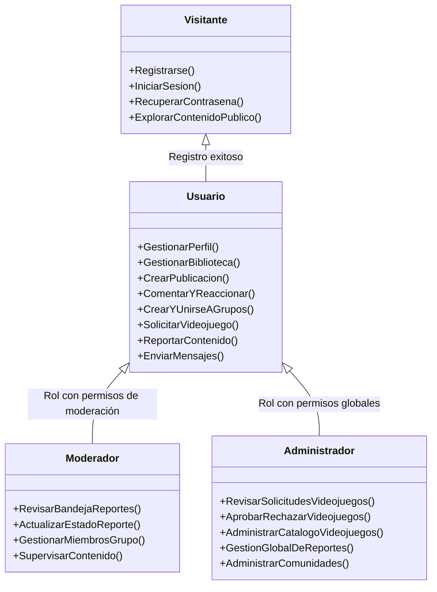

# 1.2 Identificación de los actores del sistema: visitante, usuario, moderador y administrador

## 1. Introducción y modelo de actores

En el análisis de la plataforma **Let's Play**, los actores representan a los usuarios o entidades externas que interactúan directamente con los procesos, páginas web y formularios del sistema.

Para la arquitectura funcional del proyecto se identifican **cuatro actores humanos principales** con diferentes niveles de privilegios y responsabilidades, además del **Sistema** como actor de soporte automatizado:

---

## 2. Descripción detallada de los actores

### 2.1. Visitante (Usuario no autenticado / Invitado)

* **Definición:**  
  Persona que accede a la aplicación web a través de un navegador pero que **no cuenta con una sesión activa** (no se ha autenticado o aún no posee una cuenta registrada).

* **Objetivo principal:**  
  Conocer la propuesta de la plataforma, consultar información de acceso público y crear una cuenta o ingresar con sus credenciales.

* **Capacidades y funcionalidades identificadas en el proyecto:**
  * Acceder a las pantallas públicas iniciales de la aplicación (`PLogin`, `PRegistro`, `PRecuperar`).
  * **Registrar una cuenta de usuario:** Capturar nombre de usuario (máximo 12 caracteres alfanuméricos), correo electrónico único, fecha de nacimiento, género y contraseña cifrada (**RF-01**, **RF-02**, **RF-03**, **RF-90**, **RF-91**, **RF-92**; **CU-01**; **FRegistro**).
  * **Iniciar sesión:** Proporcionar credenciales para obtener un identificador de sesión y acceder al feed y funcionalidades privadas (**RF-04**, **RF-05**; **CU-02**; **FLogin**).
  * **Recuperar contraseña:** Solicitar el restablecimiento de contraseña mediante correo electrónico registrado en caso de extravío (**RF-62**, **RF-63**; **CU-05**; **FRecuperar**).
  * *(Opcional según visualización pública):* Visualizar información pública básica si el sistema habilita una vista previa del catálogo o grupos públicos sin interactuar.

* **Restricciones del actor:**
  * **Acceso restringido (RF-07):** No puede interactuar con el feed, publicar contenido, comentar, reaccionar, unirse a grupos, enviar mensajes directos, solicitar videojuegos ni generar reportes. Debe autenticarse previamente.

---

### 2.2. Usuario (Usuario registrado / Jugador / Miembro de la comunidad)

* **Definición:**  
  Persona que cuenta con una cuenta activa y una sesión autenticada en el sistema. En los documentos del proyecto abarca los perfiles de *Jugador*, *Creador de contenido* o *Desarrollador* (que en esta fase comparten las mismas funciones base sin diferenciación de roles técnicos).

* **Objetivo principal:**  
  Participar activamente en la red social: compartir publicaciones, gestionar su biblioteca de juegos de interés, interactuar socialmente (comentarios, me gusta, mensajes), participar en comunidades públicas/privadas y sugerir nuevos videojuegos.

* **Capacidades y funcionalidades identificadas en el proyecto:**
  * **Gestión de cuenta y perfil:**
    * Consultar y modificar datos personales, descripción y fotografía de perfil (**RF-08**, **RF-10**, **RF-11**, **RF-12**; **CU-06**; **FPerfil**).
    * Consultar el perfil público de otros usuarios (**RF-09**).
    * Configurar su **biblioteca personal** asociando obligatoriamente entre **1 y 5 videojuegos aprobados** del catálogo oficial (**RF-88**, **RF-89**; **CU-06**).
    * Modificar su contraseña activa (**RF-61**; **CU-04**; **Formulario de cambio de contraseña**).
    * Eliminar su propia cuenta mediante confirmación explícita (**RF-60**, **RF-64**; **CU-07**).
    * Cerrar su sesión de forma segura (**RF-06**; **CU-03**).
  * **Feed y publicaciones:**
    * Visualizar el feed principal con publicaciones ordenadas de usuarios y grupos autorizados (**RF-20**, **RF-21**, **RF-22**; `PFeed`).
    * Crear publicaciones con texto y/o imágenes asociadas obligatoriamente a un videojuego registrado (**RF-13** a **RF-17**, **RF-86**; **CU-19**; **FPub**).
    * Visualizar publicaciones con autor, fecha y detalles (**RF-18**, **RF-19**).
    * Eliminar sus propias publicaciones con confirmación (**RF-65**).
  * **Interacciones sociales y mensajería:**
    * Reaccionar con "me gusta" y retirar su reacción en publicaciones (**RF-33**, **RF-34**, **RF-35**).
    * Agregar comentarios a publicaciones y ver el hilo de discusión (**RF-36**, **RF-37**, **RF-38**; **FComentario**).
    * Compartir publicaciones en la plataforma (**RF-39**, **RF-40**).
    * Enviar y recibir mensajes privados directos entre usuarios (**RF-76**, **RF-77**, **RF-78**; **FMensaje**).
  * **Comunidades y grupos:**
    * Consultar lista de grupos públicos disponibles (**RF-46**).
    * Unirse libremente a grupos públicos (**RF-47**; **CU-10**).
    * Enviar solicitud de ingreso a grupos privados (**RF-48**; **CU-11**; **FIngreso**).
    * Abandonar grupos a los que pertenezca (**RF-49**; **CU-13**).
    * Crear un grupo nuevo (público o privado) vinculando entre 1 y 5 videojuegos aprobados (**RF-41** a **RF-45**, **RF-84**; **CU-08**; **FGrupo**), asumiendo en dicho grupo el rol de **Administrador del Grupo**.
  * **Catálogo y solicitudes de videojuegos (Rol Jugador):**
    * Solicitar el registro de un nuevo videojuego proporcionando nombre, descripción, género, plataforma, imagen y detalles (**RF-23**, **RF-24**, **RF-25**; **CU-14**; **FSolicitudJuego**).
    * Recibir notificaciones del estado de su solicitud (aprobada/rechazada) (**RF-31**).
  * **Reportes:**
    * Reportar publicaciones, comentarios, perfiles o grupos que infrinjan normas, indicando motivo, descripción y evidencia opcional (**RF-93**, **RF-94**, **RF-95**; **CU-17**; **FReporte**).

* **Restricciones del actor:**
  * No puede eliminar ni editar publicaciones o comentarios ajenos (**RF-66**).
  * No puede acceder al contenido interno ni a publicaciones de grupos privados si no ha sido aceptado como miembro (**RF-55**, **RF-56**).
  * No puede editar directamente la base de datos oficial de videojuegos ni gestionar las páginas oficiales de los juegos (**RF-70**).

---

### 2.3. Moderador (Gestor de Contenido y Convivencia)

* **Definición:**  
  Usuario de confianza designado para salvaguardar la calidad del contenido y velar por la sana convivencia y el cumplimiento del reglamento comunitario dentro de la plataforma.  
  *Nota sobre el proyecto:* En los requisitos iniciales (**RF-96**, **RF-97**; **CU-18**), la atención de reportes se asignó temporalmente al administrador de la plataforma "sin aplicar sanciones", pero la especificación académica y de ingeniería de software distingue al **Moderador** como el actor encargado del filtro operativo de reportes y supervisión comunitaria, liberando al Administrador de las tareas cotidianas de soporte. Asimismo, se manifiesta a nivel de comunidades como **Moderador/Administrador del Grupo**.

* **Objetivo principal:**  
  Revisar, atender y clasificar los reportes emitidos por la comunidad sobre publicaciones, comentarios, perfiles y grupos inadecuados, además de gestionar la admisión y disciplina dentro de los grupos que modera.

* **Capacidades y funcionalidades identificadas en el proyecto:**
  * **Gestión y revisión de reportes comunitarios:**
    * Consultar la bandeja de reportes pendientes sobre publicaciones, comentarios, perfiles o grupos (**RF-96**; **CU-18**; `PReportes`).
    * Evaluar el contenido reportado y la evidencia adjunta (**CU-18**; **FRevReporte**).
    * Actualizar el ciclo de vida del reporte: *Pendiente*, *En revisión*, *Atendido* o *Cerrado* (**RF-97**; **CU-18**).
    * Agregar notas y comentarios de revisión para documentar las decisiones tomadas (**FRevisionReporte**).
  * **Moderación a nivel de grupo (Administrador/Moderador de Grupo):**
    * Evaluar y resolver solicitudes de admisión a grupos privados, aprobando o rechazando el ingreso de usuarios (**RF-48**, **RF-50**; **CU-12**; **FDecisionIngreso**).
    * Expulsar o dar de baja a integrantes del grupo que incumplan las normas comunitarias (**RF-51**; **CU-13**).
    * Modificar la configuración, reglas internas e información del grupo (**RF-57**; **CU-09**).
    * Gestionar los videojuegos vinculados al grupo, asegurando que se mantengan siempre entre 1 y 5 juegos autorizados (**RF-85**; **CU-09**).
  * Todas las funciones propias de un **Usuario** estándar.

* **Restricciones del actor:**
  * En el alcance de la primera versión, el sistema no aplica sanciones automatizadas severas (como borrado masivo de cuentas o bloqueos automáticos definitivos; estas quedan limitadas a revisión y seguimiento administrativo).
  * No tiene autorización para alterar el catálogo global de videojuegos ni la infraestructura técnica de la plataforma (**RF-70**).
  * En un grupo, no puede alterar la página oficial del videojuego relacionado (**RF-57**).

---

### 2.4. Administrador (Administrador de la Plataforma / Superadministrador)

* **Definición:**  
  Usuario con el máximo nivel de privilegios y facultades de gestión dentro de la plataforma web *Let's Play*. Posee control integral sobre el catálogo oficial, supervisión global de comunidades y resolución técnica y normativa de la aplicación.

* **Objetivo principal:**  
  Garantizar el correcto funcionamiento de la plataforma, mantener un catálogo oficial de videojuegos verificado y consistente, y contar con la última palabra en la moderación y gobernanza del sistema.

* **Capacidades y funcionalidades identificadas en el proyecto:**
  * **Gestión y aprobación del catálogo oficial de videojuegos:**
    * Consultar la bandeja de solicitudes de nuevos videojuegos enviadas por los jugadores (**RF-26**; **CU-15**; `PRevJuego`).
    * Aceptar solicitudes de registro de videojuegos, lo que dispara la creación o habilitación de la página oficial del videojuego en la plataforma (**RF-27**, **RF-32**; **CU-15**; **FRevJuego**, `SSolicitudJuego`).
    * Rechazar solicitudes no procedentes registrando el motivo de rechazo y la fecha de la decisión (**RF-28**, **RF-29**, **RF-30**; **CU-15**; **FRevJuego**).
    * Administrar de forma exclusiva la información publicada en las páginas de videojuegos: editar títulos, descripciones, portadas, plataformas o géneros (**RF-67**, **RF-68**; **CU-16**; `PAdminJuego`, `SAdminJuego`).
    * Deshabilitar o retirar páginas de videojuegos que ya no deban mostrarse (**RF-69**; **CU-16**).
  * **Gobernanza global de moderación y reportes:**
    * Supervisar la totalidad de reportes generados y las acciones tomadas por los moderadores (**RF-96**, **RF-97**; **CU-18**).
    * Atender controversias de contenido y emitir resoluciones definitivas sobre publicaciones, grupos o usuarios infractores.
  * **Supervisión de comunidades y cuentas:**
    * Supervisar grupos públicos y privados, pudiendo intervenir en caso de grupos con contenido ilícito o nombres inapropiados.
    * Todas las facultades de un **Usuario** y un **Moderador**.

* **Restricciones del actor:**
  * Sus operaciones deben preservar la integridad y consistencia de la base de datos (relaciones de usuarios, bibliotecas, publicaciones, comentarios y videojuegos) (**RF-81**, **RF-82**, **RF-83**).

---

## 3. Matriz comparativa de permisos por actor

La siguiente matriz resume los permisos de acceso y operación identificados en el sistema:

| Módulo / Funcionalidad | Visitante | Usuario | Moderador | Administrador | Requisitos asociados |
|---|:---:|:---:|:---:|:---:|---|
| **Registro de cuenta nueva** | ✔ | — | — | — | RF-01, RF-02, RF-90 a 92 |
| **Inicio de sesión y recuperación** | ✔ | ✔ | ✔ | ✔ | RF-04, RF-05, RF-62, RF-63 |
| **Gestión de perfil y biblioteca (1 a 5 juegos)** | ✖ | ✔ | ✔ | ✔ | RF-08, RF-10, RF-88, RF-89 |
| **Visualizar Feed principal** | ✖ | ✔ | ✔ | ✔ | RF-20, RF-21, RF-22 |
| **Crear publicaciones (texto/imagen + juego)** | ✖ | ✔ | ✔ | ✔ | RF-13 a 17, RF-86 |
| **Eliminar publicaciones propias** | ✖ | ✔ | ✔ | ✔ | RF-65 |
| **Eliminar publicaciones ajenas / moderar** | ✖ | ✖ | ✔ *(en grupo)* | ✔ *(global)* | RF-51, RF-56, RF-66 |
| **Interacciones (Me gusta, comentar, compartir)**| ✖ | ✔ | ✔ | ✔ | RF-33 a 40 |
| **Mensajería privada** | ✖ | ✔ | ✔ | ✔ | RF-76, RF-77, RF-78 |
| **Crear grupos (públicos o privados)** | ✖ | ✔ | ✔ | ✔ | RF-41 a 45, RF-84 |
| **Unirse a grupos públicos** | ✖ | ✔ | ✔ | ✔ | RF-46, RF-47 |
| **Aprobar/rechazar solicitudes de ingreso a grupo** | ✖ | ✖ | ✔ *(Admin grupo)* | ✔ | RF-48, RF-50, CU-12 |
| **Solicitar nuevo videojuego para catálogo** | ✖ | ✔ | ✔ | ✔ | RF-23 a 25, CU-14 |
| **Aprobar/rechazar solicitudes de videojuegos** | ✖ | ✖ | ✖ | ✔ | RF-26 a 30, CU-15 |
| **Editar/deshabilitar páginas de videojuegos** | ✖ | ✖ | ✖ | ✔ | RF-67 a 70, CU-16 |
| **Enviar reportes de infracción** | ✖ | ✔ | ✔ | ✔ | RF-93 a 95, CU-17 |
| **Revisar y actualizar estado de reportes** | ✖ | ✖ | ✔ | ✔ | RF-96, RF-97, CU-18 |

*Convenciones:*  
* ✔ : Cuenta con permiso directo para ejecutar la acción.  
* ✖ : Acción restringida o denegada por reglas de negocio.  
* — : No aplica (ej. un usuario ya autenticado no requiere registrarse nuevamente).

---

## 4. Conclusiones y trazabilidad con la arquitectura

1. **Visitante:** Se limita a las páginas cliente de autenticación (`PRegistro`, `PLogin`, `PRecuperar`) enviando formularios a `SAuth`.
2. **Usuario:** Es el núcleo operativo de la red social; interactúa con `PFeed`, `PPerfil`, `PPub`, `PGrupo`, `PMensajes`, enviando datos a `SPerfil`, `SPub`, `SGrupo` y `SMensaje`.
3. **Moderador:** Añade una capa de supervisión interactuando con `PReportes` y formularios de decisión de ingreso/membresía a grupos privados (`FIngreso`, `SGrupo`, `SReporte`).
4. **Administrador:** Es el único actor con acceso a `PRevJuego`, `PAdminJuego` y al proceso `SAdminJuego`, garantizando que el catálogo de videojuegos mantenga información oficial fidedigna.
