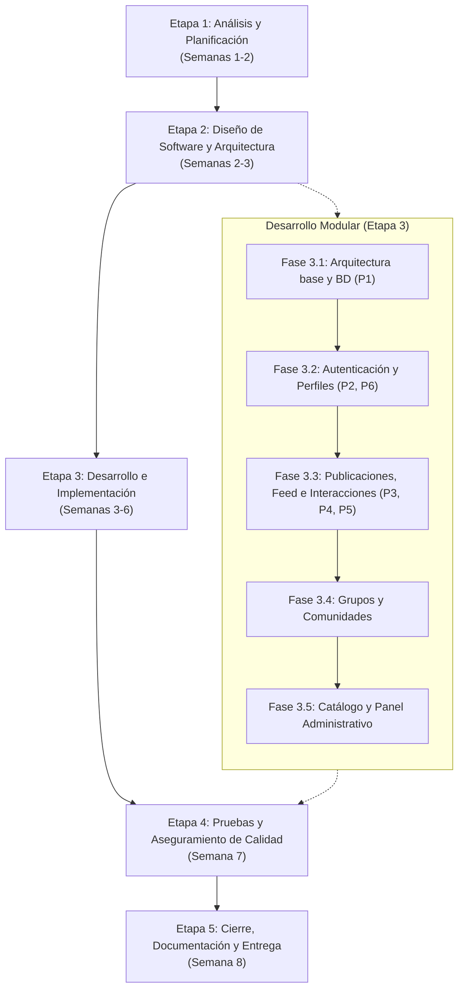

# Etapas de desarrollo del proyecto — Let's Play

> **Proyecto:** Let's Play — Plataforma web para la comunidad de videojuegos  
> **Equipo:** 3 estudiantes de Ingeniería de Software (7.° semestre: Leo, Seth, Gabo)  
> **Duración total:** 2 meses (8 semanas)  
> **Responsable de sección:** Leo  
> **Documento complementario:** Alcance y planificación del proyecto, Requisitos funcionales y Modelo WAE

---

## 1. Enfoque metodológico

El proyecto se gestiona mediante un enfoque de desarrollo **iterativo e incremental** basado en fases de ingeniería de software con entregables verificables. Dada la duración fija de dos meses y la conformación del equipo (tres desarrolladores), las actividades se organizan en **5 etapas sucesivas**, priorizando las funcionalidades críticas de arquitectura, persistencia, autenticación y publicaciones antes de los módulos secundarios.

---

## 2. Cronograma general (8 semanas)

| Semana | Etapa / Hito principal | Actividad central | Entregable formal |
|:---:|---|---|---|
| **Semana 1** | Etapa 1: Análisis | Levantamiento de requisitos y estudio de interesados | Documento de alcance y objetivos |
| **Semana 2** | Etapa 1 & 2: Análisis y Diseño | Casos de uso, formularios y arquitectura WAE | Documento de requisitos funcionales y WAE |
| **Semana 3** | Etapa 2 & 3: Diseño y Desarrollo | Modelo de base de datos e inicio de arquitectura técnica | Diagrama ER y base de datos inicial |
| **Semana 4** | Etapa 3: Desarrollo (Fase 1 y 2) | Módulo de autenticación, sesiones y perfiles | Sistema de login, registro y perfiles |
| **Semana 5** | Etapa 3: Desarrollo (Fase 3) | Feed principal, publicaciones y me gusta / comentarios | Módulo de publicaciones e interacciones |
| **Semana 6** | Etapa 3: Desarrollo (Fase 4 y 5) | Grupos públicos/privados y catálogo de videojuegos | Módulo de grupos y panel administrativo |
| **Semana 7** | Etapa 4: Pruebas y QA | Pruebas funcionales de casos de uso y corrección de bugs | Informe de pruebas y corrección de errores |
| **Semana 8** | Etapa 5: Entrega y Cierre | Documentación técnica, manual de usuario y despliegue | Aplicación funcional, código y manual |

---

## 3. Descripción detallada de las etapas

### Etapa 1: Análisis de Requisitos y Planificación
* **Duración:** Semanas 1 a 2
* **Objetivo:** Definir el alcance exacto del proyecto, acotar los límites de la primera versión, identificar a los actores del sistema y documentar todos los requisitos funcionales y restricciones.
* **Actividades principales:**
  1. Definición del problema, justificación, objetivo general y específicos.
  2. Análisis de interesados y usuarios objetivo (jugadores, desarrolladores y creadores de contenido).
  3. Levantamiento y catalogación de requisitos funcionales (**RF-01 a RF-97**).
  4. Identificación y definición formal de actores del sistema: Visitante, Usuario, Moderador y Administrador.
  5. Especificación detallada de casos de uso principales (**CU-01 a CU-19**) con flujos primarios y alternos.
  6. Especificación de formularios de entrada de datos y reglas de validación.
* **Entregables:**
  * Documento de alcance y planificación del proyecto.
  * Documento de requisitos funcionales y no funcionales.
  * Especificación de casos de uso y actores.
  * Documento de formularios de envío de información.
* **Criterio de salida:** Requisitos y casos de uso aprobados por el equipo y alineados con la primera entrega de Eminus.

---

### Etapa 2: Diseño de Software y Modelado de Arquitectura
* **Duración:** Semanas 2 a 3
* **Objetivo:** Establecer la estructura arquitectónica del software, diseñar el modelo de datos relacional y construir los prototipos de interfaz de usuario para escritorio.
* **Actividades principales:**
  1. Modelado conceptual de la aplicación web utilizando estereotipos WAE (`<<client page>>`, `<<server page>>`, `<<form>>`, `<<entity>>`).
  2. Diseño del diagrama entidad-relación (ER) y esquema de tablas persistentes (usuarios, perfiles, publicaciones, comentarios, reacciones, grupos, membresías, solicitudes y catálogo de videojuegos).
  3. Definición de restricciones de integridad (ej. biblioteca de 1 a 5 videojuegos, pertenencia a grupos, visibilidad pública/privada).
  4. Diseño de prototipos y wireframes de interfaces de usuario (UI/UX) para entorno de escritorio (login, feed, perfil, grupo, paneles de revisión).
* **Entregables:**
  * Documento del Modelo WAE de la aplicación.
  * Diagrama entidad-relación y modelo de base de datos documentado.
  * Prototipos de pantallas principales (UI/UX).
* **Criterio de salida:** Esquema de base de datos y modelo de navegación validados técnica y funcionalmente.

---

### Etapa 3: Desarrollo e Implementación
* **Duración:** Semanas 3 a 6
* **Objetivo:** Codificar de forma modular la aplicación web en Next.js, React y Node.js, integrando la base de datos persistente conforme a las prioridades definidas.
* **Organización modular (Sprints de desarrollo):**
  * **Fase 3.1 — Arquitectura base y persistencia (Prioridad 1):**  
    Configuración del entorno de desarrollo (VS Code, repositorio Git), estructura del proyecto Next.js y creación del esquema de la base de datos con scripts DDL y conexiones persistentes.
  * **Fase 3.2 — Sistema de autenticación y perfiles (Prioridades 2 y 6):**  
    Desarrollo del registro de usuarios con validaciones (nombre alfanumérico ≤ 12 caracteres, correo único), inicio de sesión con hash seguro de contraseñas, recuperación de contraseña y edición de perfil con biblioteca personal de 1 a 5 juegos aprobados.
  * **Fase 3.3 — Publicaciones, Feed e Interacciones (Prioridades 3, 4 y 5):**  
    Desarrollo del feed principal, creación de publicaciones de texto/imagen asociadas a un videojuego, sistema de reacciones ("me gusta"), comentarios anidados y mensajería privada.
  * **Fase 3.4 — Módulo de comunidades y grupos:**  
    Creación de grupos públicos y privados vinculados a 1-5 videojuegos, sistema de solicitudes de ingreso con aprobación del administrador del grupo, expulsión de integrantes y aislamiento de publicaciones privadas.
  * **Fase 3.5 — Catálogo de videojuegos y panel administrativo:**  
    Módulo para que los jugadores soliciten títulos, panel administrativo de revisión (aprobar/rechazar solicitudes de videojuegos), gestión de páginas oficiales de videojuegos y panel de consulta de reportes comunitarios.
* **Entregables:**
  * Base de datos integrada y poblada con datos de prueba.
  * Módulo funcional de autenticación y perfiles.
  * Módulo funcional de publicaciones, feed e interacciones.
  * Módulo funcional de grupos y comunidades.
  * Módulo funcional de catálogo de videojuegos y paneles administrativos.
* **Criterio de salida:** Todos los módulos del alcance integrados en una rama funcional y operativos en servidor local.

---

### Etapa 4: Pruebas y Aseguramiento de Calidad (QA)
* **Duración:** Semana 7
* **Objetivo:** Verificar y validar que la aplicación cumpla con las especificaciones de requisitos, casos de uso y criterios de finalización sin fallos críticos.
* **Actividades principales:**
  1. Diseño y ejecución de matrices de casos de prueba funcionales basados en los casos de uso (**CU-01 a CU-19**).
  2. Pruebas de límites y validación de reglas de negocio:
     * Restricción estricta de 1 a 5 videojuegos en perfiles y grupos.
     * Restricción de acceso no autenticado a funciones privadas (**RF-07**).
     * Privacidad de publicaciones en grupos privados.
     * Prevención de duplicados en videojuegos y usuarios.
  3. Pruebas de integración entre frontend (Next.js/React), backend (Node.js) y base de datos.
  4. Registro de incidencias (bugs), depuración y corrección de errores identificados.
* **Entregables:**
  * Matriz y casos de prueba ejecutados.
  * Informe de resultados de pruebas y corrección de errores críticos.
* **Criterio de salida:** 100% de los casos de uso críticos aprobados y ausencia de errores bloqueantes.

---

### Etapa 5: Cierre, Documentación Final y Entrega
* **Duración:** Semana 8
* **Objetivo:** Consolidar el proyecto en su versión de entrega formal, compilar la documentación técnica y elaborar el manual de usuario.
* **Actividades principales:**
  1. Integración de la versión final estable de la aplicación web *Let's Play*.
  2. Limpieza y preparación del repositorio de código fuente con etiquetas de versión (*release*).
  3. Redacción del manual de instalación, configuración del entorno y ejecución de la aplicación.
  4. Redacción del manual de usuario final con instrucciones detalladas paso a paso para cada actor del sistema.
  5. Preparación de la demostración y presentación del proyecto para la entrega final académica.
* **Entregables formales:**
  * Aplicación web funcional integrada.
  * Código fuente completo con documentación técnica y archivo `README` de instalación.
  * Manual de usuario final.
  * Informe final del proyecto consolidado.
* **Criterio de salida:** Cumplimiento total de los criterios de finalización definidos en el alcance y entrega en la plataforma Eminus.

---

## 4. Matriz de responsabilidades por etapa (RACI)

Distribución de responsabilidades del equipo de trabajo (Leo, Seth, Gabo):

| Etapa | Leo | Seth | Gabo |
|---|:---:|:---:|:---:|
| **Etapa 1: Análisis y Requisitos** | Responsable (**R**) | Responsable (**R**) | Responsable (**R**) |
| **Etapa 2: Diseño y Arquitectura** | Consultado (**C**) | Responsable (**R**) / WAE | Responsable (**R**) / BD |
| **Etapa 3: Desarrollo e Implementación** | Responsable (**R**) / Frontend & Feed | Responsable (**R**) / Auth & Grupos | Responsable (**R**) / BD & Admin |
| **Etapa 4: Pruebas y QA** | Responsable (**R**) / Pruebas funcionales | Responsable (**R**) / Casos de prueba | Responsable (**R**) / Integración |
| **Etapa 5: Cierre y Documentación** | Responsable (**R**) / Manual usuario | Responsable (**R**) / Doc. Técnica | Responsable (**R**) / Empaquetado |

*Convenciones RACI:* **R** = Responsable de ejecución, **C** = Consultado / Colaborador.
