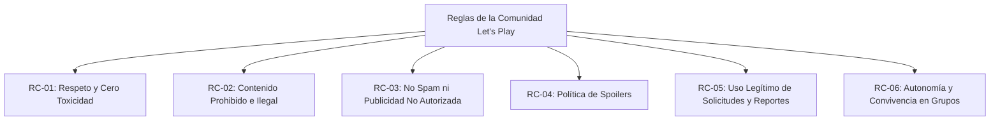

# 1.2 Reglas de negocio y reglas de la comunidad — Let's Play

> **Proyecto:** Let's Play — Plataforma web para la comunidad de videojuegos  
> **Documento:** Especificación de Reglas de Negocio y Normas de la Comunidad  
> **Responsable:** Li0 (Leo)  
> **Trazabilidad:** Tarjeta 12 de Trello, Requisitos funcionales (RF-01 a RF-97), Casos de uso (CU-01 a CU-19), Formularios y Modelo WAE.

---

## 1. Introducción y propósito

Este documento establece las **Reglas de Negocio (RN)** que gobiernan el funcionamiento lógico del sistema *Let's Play* y las **Reglas de la Comunidad (RC)** que orientan la interacción, sana convivencia y conducta esperada de los usuarios dentro de la plataforma.

Las Reglas de Negocio son políticas y restricciones formales que deben implementarse obligatoriamente a nivel de software (validaciones de interfaz, lógica de servidor en Node.js y restricciones de integridad en base de datos), mientras que las Reglas de la Comunidad definen los criterios éticos que fundamentan los reportes y la moderación comunitaria.

---

## 2. Reglas de Negocio del Sistema (RN)

### 2.1. Cuentas, registro y autenticación

| ID | Nombre de la regla | Descripción y validación formal | RF / CU Asociado |
|---|---|---|---|
| **RN-01** | **Formato y unicidad del nombre de usuario** | El nombre de usuario es obligatorio, único en la plataforma, con una longitud máxima de 12 caracteres y compuesto exclusivamente por caracteres alfanuméricos (letras y números sin espacios ni caracteres especiales). | RF-02, RF-03, RF-92 CU-01 |
| **RN-02** | **Unicidad y validez del correo electrónico** | Toda cuenta debe registrarse con una dirección de correo electrónico única y con formato de sintaxis RFC válido. No se permite registrar múltiples cuentas con el mismo correo. | RF-02, RF-03 CU-01 |
| **RN-03** | **Almacenamiento seguro de contraseñas** | Las contraseñas nunca deben almacenarse ni transmitirse en texto plano. En la base de datos se almacena únicamente un hash criptográfico unidireccional con sal (*salt*) generado mediante algoritmos seguros (bcrypt o argon2). | RF-05, RF-63 CU-01, CU-02 |
| **RN-04** | **Restricción de acceso a funciones privadas** | Todas las funcionalidades que impliquen interacción social, consulta de feeds privados, creación de contenido, unión a grupos o envío de mensajes exigen una sesión de usuario válida y autenticada. Un visitante no autenticado solo puede acceder a pantallas públicas (registro, login y recuperación). | RF-04, RF-05, RF-07 CU-02, CU-03 |
| **RN-05** | **Verificación de identidad para recuperación de credenciales** | La recuperación y restablecimiento de contraseña requiere comprobar la identidad mediante un token temporal unívoco asociado al correo registrado y con tiempo de expiración definido. | RF-61, RF-62, RF-63 CU-04, CU-05 |

---

### 2.2. Perfiles y biblioteca personal de videojuegos

| ID | Nombre de la regla | Descripción y validación formal | RF / CU Asociado |
|---|---|---|---|
| **RN-06** | **Rango estricto de la biblioteca personal** | Todo usuario registrado debe relacionar con su perfil un **mínimo de 1 y un máximo de 5 videojuegos aprobados** del catálogo oficial. El sistema rechazará cualquier intento de guardar el perfil con 0 videojuegos o con más de 5 títulos. | RF-88, RF-89 CU-06 |
| **RN-07** | **Restricción a videojuegos aprobados en bibliotecas** | Los videojuegos seleccionables para la biblioteca personal deben pertenecer forzosamente al catálogo oficial verificado y aprobado de la plataforma; no se permite asociar videojuegos no registrados o en estado pendiente. | RF-88, RF-89 CU-06 |
| **RN-08** | **Confirmación explícita para baja de cuenta** | Un usuario solo puede solicitar la eliminación de su propia cuenta desde su perfil. El sistema debe solicitar confirmación explícita de seguridad antes de procesar la baja y cerrar inmediatamente la sesión activa. | RF-60, RF-64 CU-07 |

---

### 2.3. Publicaciones y contenido social

| ID | Nombre de la regla | Descripción y validación formal | RF / CU Asociado |
|---|---|---|---|
| **RN-09** | **Vinculación obligatoria a un videojuego** | Toda publicación general debe estar asociada obligatoriamente a exactamente un videojuego registrado en la plataforma. No se permiten publicaciones huérfanas sin videojuego temático. | RF-13, RF-16, RF-17 CU-19 |
| **RN-10** | **Contenido mínimo de una publicación** | Una publicación debe contener texto descriptivo que respete la longitud máxima permitida y puede incluir de manera opcional un archivo de imagen en formato gráfico válido (`.jpg`, `.jpeg`, `.png`, `.webp`) que no exceda el tamaño máximo estipulado. | RF-14, RF-15, RF-16 CU-19 |
| **RN-11** | **Propiedad y restricción de borrado de publicaciones** | Un usuario únicamente tiene permisos para eliminar publicaciones de las cuales sea autor legítimo. El sistema impedirá cualquier intento de eliminación de publicaciones o comentarios realizados por otros usuarios. | RF-65, RF-66 |
| **RN-12** | **Unicidad de reacciones por usuario** | Un usuario puede registrar como máximo una reacción de "me gusta" por cada publicación. Si reacciona de nuevo sobre la misma publicación, la reacción previa se retira (acción de alternancia / *toggle*). | RF-33, RF-34, RF-35 |

---

### 2.4. Comunidades y grupos (Públicos y Privados)

| ID | Nombre de la regla | Descripción y validación formal | RF / CU Asociado |
|---|---|---|---|
| **RN-13** | **Videojuegos vinculados por grupo** | Todo grupo, independientemente de que sea público o privado, debe asociarse inicialmente y mantener permanentemente entre **1 y 5 videojuegos aprobados**. El administrador del grupo puede añadir, editar o remover títulos siempre que conserve al menos 1 y máximo 5 juegos. | RF-45, RF-84, RF-85 CU-08, CU-09 |
| **RN-14** | **Restricción temática de publicaciones en grupos** | Toda publicación realizada dentro de un grupo debe seleccionar forzosamente uno de los videojuegos vinculados a dicho grupo. El sistema rechazará cualquier intento de publicar seleccionando un videojuego no asociado al grupo. | RF-86, RF-87 CU-19 |
| **RN-15** | **Política de membresía para grupos públicos** | En los grupos de tipo `PUBLICO`, cualquier usuario con sesión activa puede unirse de forma directa e inmediata sin requerir aprobación. El contenido del grupo es accesible para todos los integrantes. | RF-46, RF-47 CU-10 |
| **RN-16** | **Aprobación obligatoria para grupos privados** | En los grupos de tipo `PRIVADO`, el ingreso no es automático: el usuario debe emitir una solicitud de ingreso y el Administrador del grupo debe aceptarla formalmente para conceder la membresía. | RF-48, RF-50 CU-11, CU-12 |
| **RN-17** | **Aislamiento de contenido en grupos privados** | Las publicaciones, discusiones y lista interna de integrantes de un grupo privado están estrictamente restringidas a los miembros aceptados. Ningún usuario ajeno ni visitante puede visualizar dicho contenido. | RF-54, RF-55, RF-56 |
| **RN-18** | **Jerarquía y facultades de administración del grupo** | El usuario creador del grupo se convierte automáticamente en Administrador del Grupo. Tiene facultades para modificar los datos del grupo, gestionar solicitudes de ingreso, expulsar miembros o eliminar el grupo; pero **no tiene facultades para alterar las páginas oficiales de videojuegos**. | RF-44, RF-50, RF-51, RF-52, RF-57 CU-09, CU-12, CU-13 |

---

### 2.5. Catálogo oficial de videojuegos

| ID | Nombre de la regla | Descripción y validación formal | RF / CU Asociado |
|---|---|---|---|
| **RN-19** | **Flujo de alta y aprobación de videojuegos** | Los usuarios (rol Jugador) solo pueden solicitar la inclusión de un título mediante el formulario correspondiente. La solicitud queda en estado `PENDIENTE` y no se muestra en el catálogo oficial hasta que sea revisada y aceptada por el Administrador de la plataforma. | RF-23, RF-25, RF-32 CU-14, CU-15 |
| **RN-20** | **Resolución motivada de solicitudes de videojuegos** | Al revisar una solicitud, el Administrador de la plataforma decide aceptarla o rechazarla. En caso de rechazo, el sistema debe registrar el motivo y la fecha, e informar el resultado al jugador solicitante. | RF-27 a RF-31 CU-15 |
| **RN-21** | **Reserva de administración de páginas de videojuegos** | La creación, edición de metadatos, actualización de portadas y deshabilitación de páginas del catálogo de videojuegos es potestad exclusiva del Administrador de la plataforma. Los usuarios comunes no tienen permisos de edición sobre el catálogo. | RF-67 a RF-70 CU-16 |

---

### 2.6. Reportes y moderación

| ID | Nombre de la regla | Descripción y validación formal | RF / CU Asociado |
|---|---|---|---|
| **RN-22** | **Atribución y datos requeridos del reporte** | Cualquier usuario autenticado puede generar un reporte sobre una publicación, comentario, perfil o grupo. El reporte debe especificar obligatoriamente el tipo de contenido, el identificador de la entidad, un motivo categorizado y una descripción explicativa. | RF-93, RF-94, RF-95 CU-17 |
| **RN-23** | **Ciclo de vida y limitación de sanciones en versión 1** | Los reportes se registran con estado inicial `Pendiente`. Únicamente Moderadores y Administradores pueden actualizar su estado a `En revisión` o `Cerrado`. Acorde al alcance inicial, el sistema no aplica sanciones automáticas directas (suspensiones o expulsiones masivas de cuentas quedan reservadas a revisión manual). | RF-96, RF-97 CU-18 |

---

## 3. Reglas de la Comunidad (Normas de Convivencia Gamer)

Las siguientes normas rigen la conducta esperada de los usuarios para mantener a **Let's Play** como un espacio seguro, respetuoso y constructivo para todos los entusiastas de los videojuegos:

### RC-01 — Respeto mutuo y cero tolerancia a la toxicidad
* Queda estrictamente prohibido el acoso, hostigamiento, amenazas, discursos de odio, insultos personales o discriminación por motivos de género, raza, nacionalidad, orientación o religión.
* Se promueve el debate apasionado sobre videojuegos, pero se sancionan las conductas hostiles destructivas (*flaming*) y la toxicidad en discusiones de comunidades o comentarios.

### RC-02 — Prohibición de contenido inapropiado o ilícito
* **No contenido para adultos (NSFW):** Prohibido publicar imágenes, enlaces o textos con contenido pornográfico, sexual explícito o violencia gráfica extrema.
* **Cero piratería:** Prohibido compartir o solicitar enlaces de descarga ilegal de videojuegos comerciales, cracks, keygens, software malicioso (*malware*) o contenido protegido por derechos de autor sin autorización.

### RC-03 — Política contra Spam y autopromoción desmedida
* Prohibido el envío reiterativo de mensajes o comentarios idénticos con fines de saturación (*spam*).
* No se permite la publicidad masiva de servicios ajenos, esquemas de estafa o venta de cuentas de videojuegos. Los creadores y desarrolladores pueden compartir sus avances y proyectos conforme a las pautas de sus grupos temáticos.

### RC-04 — Política de Spoilers (Protección de la experiencia ajena)
* Toda publicación o comentario que revele detalles cruciales de la trama, desenlaces o sorpresas argumentales de videojuegos recientes o de alta relevancia narrativa debe advertirlo explícitamente al inicio del texto utilizando el aviso `[SPOILER]`.

### RC-05 — Uso legítimo de solicitudes y reportes
* Las solicitudes de nuevos títulos para el catálogo deben corresponder a videojuegos reales y verificables, con información fidedigna.
* El sistema de reportes debe utilizarse exclusivamente para denunciar infracciones reales al reglamento. Se prohíbe el uso fraudulento de reportes falsos como mecanismo de acoso o represalia contra otros usuarios.

### RC-06 — Autonomía y gobernanza interna de grupos
* Los administradores de grupos pueden establecer normas específicas de convivencia interna para su comunidad (ej. reglas para búsqueda de compañeros *LFG*, horarios de partidas o temáticas de debate).
* Ninguna regla interna de un grupo privado o público puede contradecir las Reglas Generales de la Comunidad ni las Reglas de Negocio del sistema *Let's Play*.

---

## 4. Matriz de aplicación y consecuencias

| Infracción detectada | Regla infringida | Acción del sistema / moderación |
|---|:---:|---|
| Registro con nombre ofensivo o duplicado | RN-01, RC-01 | Rechazo automático en validación de formulario. |
| Intento de guardar biblioteca con 0 o >5 juegos | RN-06 | Rechazo automático por regla de integridad (frontend y backend). |
| Intento de publicar en grupo con juego no asociado | RN-14 | Bloqueo automático de envío con mensaje de error informativo. |
| Publicación de contenido ofensivo, spam o NSFW | RC-01, RC-02, RC-03 | Reporte ciudadano (`CU-17`), revisión por moderador/admin (`CU-18`) y retiro de la publicación. |
| Intromisión no autorizada a grupo privado | RN-16, RN-17 | Denegación de acceso y redirección a página de solicitud de ingreso. |
| Envío de solicitudes falsas de videojuegos | RN-19, RC-05 | Rechazo fundamentado de la solicitud por parte del Administrador de la plataforma. |
